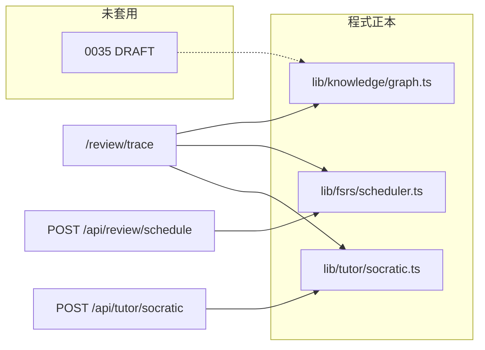
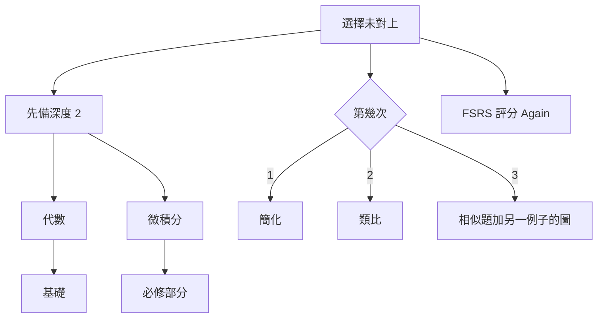
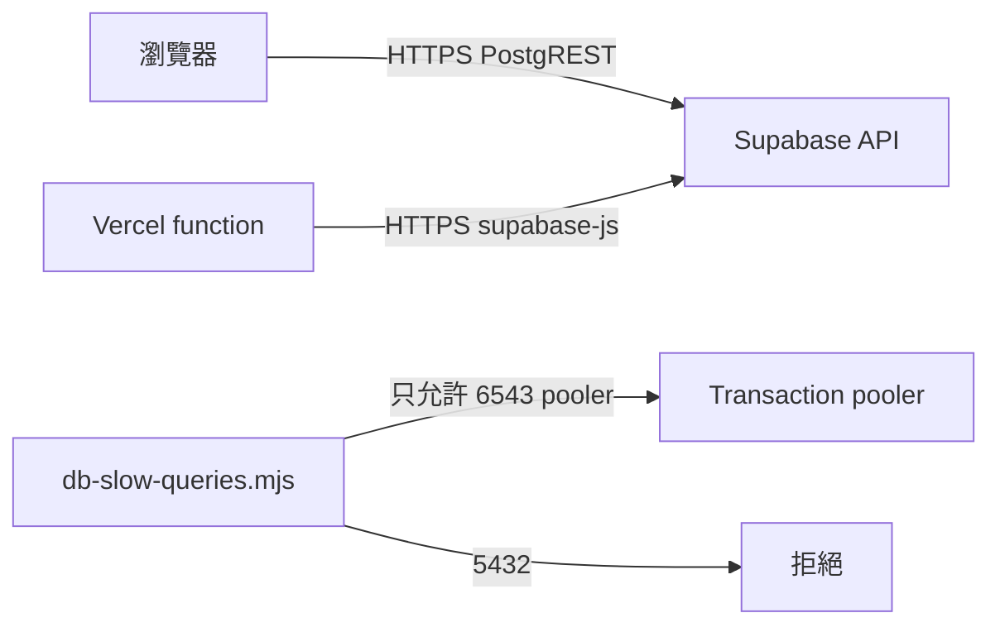

# 架構

## 資料

學生看到的圖和排程以程式正本為準。草稿表要等批准才會成為雲端副本。

## 答錯微分

## 連線

## 重新驗證

`/review/trace` 跟全站一樣是動態頁（CSP nonce，不能 `revalidate`）。`POST /api/revalidate` 帶 `Authorization: Bearer <CRON_SECRET>`，路徑只可以是 `/review/trace`。題庫不走這條路。

## 介面參考

Mobbin 這次沒有可用結果，見 `docs/research/ui-references/README.md`。Canva Open Graph 在 `docs/research/canva/og-dse-level-up.png`。
