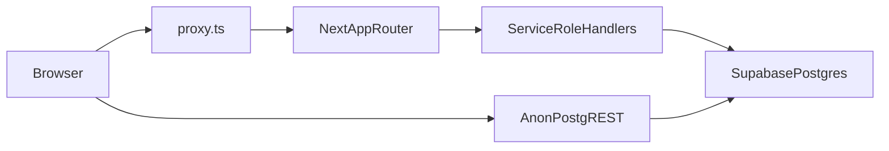

# DSE Level Up v6 Phase 1 研究

- **狀態：** Phase 1 完成；已批准進入 Phase 2（見 `phase-2-problem-definition.md`）
- **研究日期：** 2026-11-04（Asia/Hong_Kong）
- **基線 commit：** `95134df`（`main`，Merge pull request #175）
- **方法：** 唯讀。讀 migration、route、auth、同步、私隱頁、CI。未連線 production Supabase，未改 code，未跑 migration。
- **用途：** 之後 Phase 2／4B 嘅約束。本文件唔授權改產品、改 RLS、轉 key 或搬學生資料。

---

## 0. 已寫入嘅約束

2026-11-04 批准撰寫本文件時，一併採納下列五項。子決定標明「工作預設」，法律頁、migration、CI gate 落地前仍要你一句確認。三項 P0 問題未答之前，**禁止** production migration、key rotation、RLS 變更、資料遷移。

### D1. PDPO 保留期同刪除權（已採納）

- 登入用戶嘅學習資料：**用緊就保留**，唔設盲目 TTL。
- 主動刪帳戶：請求後 **7 日可撤回**；第 8 至 30 日內完成 anonymization 或 deletion，並留刪除憑證同 audit log。呢個係「請求後 30 日內做完」，唔係「資料 30 日自動過期」。
- `auth.users` 要一併刪除或徹底匿名化。若要留審計列，email、phone、identifiers 必須清走，`user_id` 換成不可逆 pseudonymous ID。只停用帳戶唔算刪除。
- 未登入本機資料：提供「清除本機學習資料」，清 localStorage、IndexedDB、Cache Storage、PWA cache。呢個係本機刪除，唔等於雲端刪除。
- 未成年：已驗證學生可提刪除。家長或監護人代提，必須先完成可審計嘅身份與關係驗證。

**工作預設 S1（未最終確認）：** 個人可識別資料硬刪或不可逆匿名化；可保留去識別化 aggregate metrics。

### D2. 未成年同意邊界（已採納）

- 現有已登記用戶**維持同步**，唔一刀切暫停。
- **13 歲以下：** 要有可驗證嘅家長或法定監護人同意，先可開雲端帳戶同同步。未完成前只可本機、唔同步。
- **13 至 18 歲：** 學生可開戶，註冊必須聲明年齡，並提供家長／監護人通知或同意。
- **可代同意或代刪除：** 只接受 `parent`、`legal_guardian`。`grandparent`、`domestic_helper`、兄長、教師、社工冇自動同意權，除非有書面授權同可審計驗證。
- 同意紀錄要有版本、關係、時間、撤回。IP／device fingerprint 只可短留作防濫用。證明文件只可存 hash。
- 下次登入補年齡聲明、同意版本、以及必要時嘅家長同意。補錄**唔可以**封鎖學生讀取自己已有進度。

**工作預設 S2（未最終確認，要法律意見）：** 13–15 歲強制家長同意；16–18 歲通知加可選同意。

### D3. 性能預算同低端機（已採納為目標）

基準機：約 4 年前入門 Android，網絡按離島 4G。

| 指標 | 目標 |
|---|---|
| 首頁 JS（gzip） | ≤ 150 KB |
| 練習頁首次互動前 JS | ≤ 180 KB |
| 科目題庫 | 按科 dynamic import，唔預載全庫 |
| LCP | ≤ 2.5 秒 |
| INP | ≤ 200 ms |
| CLS | ≤ 0.1 |
| 圖片 | WebP／AVIF，單張 ≤ 80 KB，lazy load |
| RLS 讀取 p95 | ≤ 200 ms |
| 離線恢復 | 重新上線後合併，唔覆蓋學生進度 |

首頁只載導航、登入狀態、核心 CTA、下一個學習行動。練習頁按科目／課題分開 cache 題目、解析、媒體。IndexedDB 只做離線草稿、已完成節、重溫佇列。Server 係 source of truth。

**工作預設 S3（未最終確認）：** 首頁 JS ≤ 150 KB、INP ≤ 200 ms、LCP ≤ 2.5 秒係 **v6 相關發布嘅 release blocker**。而家未量度現況 bundle。Gate 落地前要先有 baseline，避免未量度就卡住同 v6 無關嘅 hotfix。超標先適用於 v6 改動嘅頁，以及相對 baseline 嘅回歸。

### D4. 舊錯題／重溫遷移同 checksum（已採納）

- 遷移前 production 必須已有 PITR／backup，並且做過 restore drill。未有就係 P0 前置，唔開工。
- 雲端 JSON blob 先拆成 row，原始 blob 保持 read-only migration source，直到 checksum 通過。
- 本機錯題逐筆 checksum。建議 key：`hash(user_id + subject_id + topic_id + question_id + attempt_timestamp + normalized_answer + version)`。
- 課題級 `dse_review_done` 遷去 `review_items`／`review_schedule` 時，保留原始課題級紀錄。
- `0030` 嘅 `practice_attempts` **不可假設已上生產**。腳本要偵測 table／column，缺就跳過並記錄。
- 切換條件：雲端加本機逐筆對帳，**丟失率 0**。checksum 唔夾就人工覆核，禁止自動覆蓋。
- 用 dual-write 或 staging table。驗證完成先切 read path。

**工作預設 S4（未最終確認）：** 舊 JSON blob 驗證後再留 90 日，然後先刪，並寫上 Security & Privacy 頁。

### D5. 共用裝置、共用 IP、離線合併（已採納）

最高原則：學生進度唔可以因為環境限制而丟失。

共用裝置：

- 登出預設清除 session、auth token、上一個 user 嘅 localStorage／IndexedDB／Cache Storage。
- 若有未同步資料：先嘗試同步，成功先清。失敗就唔好靜默清走。
- 可加「訪客／共用模式」：短 session、閒置 15 分鐘鎖定、登出即清。

共用 IP：

- 學校、宿舍、劏房、屋邨 NAT **只可限流，不可封禁**。
- 已登入優先以 `user_id` 做 key。IP 只用於匿名流量同異常偵測。
- 目標：已登入 20 req／min；匿名 IP 60／min、burst 100；已登記共用 IP 白名單 burst 500／min，只 log 唔 block。
- 白名單由管理員建立：機構名稱、IP／CIDR、申請人、生效期、審批人。學生自行申報不可自動放行。
- **實作約束：** 而家一節練習會打 progress、session、practice-count。20／min 如果係全 API 共用一桶，活躍學生可能被自己嘅正常同步打中。Phase 4B 要按 endpoint 分桶，唔好一個全球桶套落所有路由。`/api/practice-count` 現有學校放寬（120／10 分鐘）喺新設計落地前維持。

離線合併：

- 未完成節：**禁止**用牆鐘贏家覆蓋。改 append-only operation log。同一題或同一節多次作答，用 deterministic key 合併，保留最後有效狀態，同時保留中間紀錄。
- 已完成節：維持 union。兩邊各自完成嘅節要加埋，唔好後寫覆蓋前寫。
- 衝突：`client_updated_at` 加 `device_id` 做 tie-breaker，並留 conflict log。必要時畀學生揀。
- 唔好用「最新 timestamp 贏」去覆蓋成節。

**工作預設 S5（未最終確認）：** 共用裝置登出時若仍有未同步資料，**強制提示必須選擇**，並寫明風險。唔採用「自動保留 24 小時」。

### 未答就禁止後期落地嘅三項（P0 open questions）

1. 生產 Supabase project 同 staging project 分別係邊個？
2. `main` 係咪唯一生產部署來源？有冇 preview／staging branch 保護？
3. 保安事故由邊個負責？現有 backup／PITR、RTO、RPO 係咩？

---

## 1. Executive summary

本站係免費、無廣告嘅 DSE 練習系統：25 科、已發布 26419 題。登入只得 Supabase Auth，憲章禁止重建 Auth.js。進度係雲端 JSON，錯題本機上限 200，重溫係課題級本機資料。用戶表 RLS 零 policy，寫入經 service role；題庫 anon 只讀。未見 service role 入瀏覽器，亦無 Storage。v6 被生產 schema、PITR、共用裝置殘留、未完成節覆蓋、刪帳未刪 auth.users、以及未成年同意缺口擋住。未確認生產項目、部署來源同事故負責人之前，不得做 production migration。

---

## 2. 研究方法同限制

- 讀 `docs/charter.md`、`package.json`、`proxy.ts`、`supabase/migrations/`、`supabase_schema.sql`、`lib/sync.ts`、`lib/privacy/userData.ts`、`app/api/progress/route.ts`、`app/api/account/delete/route.ts`、`.github/workflows/ci.yml`。
- 對照 2026-10-31 產品審計 `docs/FIRST-MAJOR-UPDATE-AUDIT-2026-10-31.md`。今次範圍更闊：保安、私隱、成本、共融、離線、共用 IP。
- **未驗證：** 遠端 RLS／grant 係咪同 repo 一致、0030 有冇人手 apply、PITR、Vercel 生產 branch、真實學生列數、現況 JS gzip、`npm audit`（環境無 `node_modules`）。
- 無輸出 secret 值。Founder 電郵白名單只記「硬編碼」，唔抄地址。

---

## 3. 憲章衝突（prompt 唔可以靜默覆蓋）

| 題目 | 憲章／程式 | v6 prompt | 本階段決定 |
|---|---|---|---|
| Auth | 2026-10-30：只准 Supabase Auth Google。禁止重建 Auth.js／Better Auth | 寫 Auth.js v5 | **跟憲章。** Phase 4B 沿用 `@supabase/ssr` |
| 入庫 | §12 機器閘自動上線，人手事後退回 | 未審核不可外露 | 設計可寫，改閘先要修憲章 |
| 遊戲化 | §8.1 解禁。排行榜同打卡 streak 已拆。`PracticeRankCard` 仍有個人段位同 EXP，註明唔顯示他人排名、唔顯示距離 5** | 唔加 XP／排行榜／streak | v6 唔新增。個人段位凍結定移除，另議 |
| 等級估算 | `/predictor` 同 `lib/mastery.ts` 係「練習表現估算」 | 暫緩等級預測 | 唔擴展，亦未經批准唔刪 |
| 成本 | 每月 US$200，`scripts/budget-guard.mjs` | 要成本帽同 circuit breaker | 帽已存在。Runtime breaker 未有。新表先要證明唔爆帽 |
| 未登入進度 | C1：未登入只可分頁記憶體，唔寫長期 `dse_progress` | 離線草稿 | 長期本機進度若覆蓋 C1，先要修憲章 |
| 0030 | 檔頭寫未經「批准發布」唔好 apply production | 新學習表 | **不可假設已上線** |

---

## 4. Current architecture map

### 技術棧（以 `package.json` 為準）

- Next.js `^16.4.2`、React `19.2.4`、Tailwind 4、`next build --webpack`、dev port 3001。
- Supabase：`@supabase/supabase-js` `^2.108.2`、`@supabase/ssr` `^0.7.0`。
- 無 Drizzle、無 Chart.js／D3／Recharts、無 `next-auth`。
- 唯一邊界檔係 `proxy.ts`。CI 會拒絕再出現 `middleware.ts`。

### `proxy.ts` 做咩、唔做咩

做：非 www／舊域 308 去 `https://www.dselevelup.com`；production CSP nonce；`/api/*`（除 `/api/health`）同 `/auth/callback` 限流。

唔做：登入閘。`/admin`、`/founder`、`/dashboard` 嘅授權喺 page／handler，唔喺 edge。

Matcher：`/((?!_next/static|_next/image|.*\\.[a-zA-Z0-9]+$).*)`。有副檔名嘅 `sw.js`、`manifest`、`robots.txt`、`sitemap.xml` 唔經呢個 proxy，所以唔會被 auth 誤攔。`/monitoring`（Sentry tunnel）無副檔名，仍入 matcher。

限流係**單機記憶體**。註釋寫明 Vercel isolate 之間唔共享，唔係分散式限流。

| 桶 | 現況 |
|---|---|
| 一般 `/api/*` | 每 IP 60／分鐘 |
| `/auth/callback`、auth 敏感 | 每 IP 30／10 分鐘 |
| `/api/report`、`/api/feedback` | 再加 10／10 分鐘 |
| `/api/practice-count` | 120／10 分鐘（註釋寫明照顧學校共用 IP） |
| `/api/health` | 豁免 |

IP 取 `x-forwarded-for` 第一段，否則 `x-real-ip`，否則字串 `anon`。平台有冇覆寫轉發頭，**未驗證**。

### Route 地圖（分組，唔逐檔抄）

主學習線：`/` → `/start` 或 `/subjects` → `/subjects/[subject]` → `/practice` → `/result` → `/dashboard`。

帳戶同信任：`/account`、`(auth)/sign-in`、`(auth)/sign-up`、`/auth/callback`、`/privacy`、`/terms`、`/trust`、`/transparency`、`/methodology`、`/about`、`/community-safety`。

平行面（會搶注意力，v6 唔擴展）：`/predictor`、`/paper-warrior`、`/answer-sheet`、`/sensei`、`/ai/practice-generator`、`/ai/study-plan`、`/ai/past-paper-explainer`、`/relax/*`、`/cantonese`、`/off-syllabus`、`/notes`、`/writing`、`/reading`、`/exam-day`、`/capsule`、`/concept-net`、`/logic-log`、`/source-lab`、SEO 學科頁（`/dse-maths`、`/dse-english`、`/dse-physics`）。

內部：`/admin`、`/founder/*`、`/dev/answer-cards`、`/dev/long-session`。`/sentry-example-page` 同 `/api/sentry-example-api` 喺 production `notFound()`。

API（變更用戶資料嘅，全部用 server session，唔信 client `user_id`）：

- `POST/GET /api/progress`：`getSyncUserId()`，POST 有 `CLOUD_PROGRESS_KEYS` allow-list。
- `POST/GET/DELETE /api/sync/settings`：session 加 sanitise。
- `POST /api/sync/session`：session，無 body user id。
- `POST/GET /api/privacy/consent`：session，版本由 server 定。
- `POST /api/account/delete`、`/api/me`：session，要 `{ confirm: true }`。
- `POST /api/auth/migrate-legacy`：session；legacy sub 只從 IdP 讀。

刻意匿名、無 user ownership：`/api/report`、`/api/feedback`、`/api/practice-count`、`/api/result/verify`、`/api/push/subscribe`、`/api/exam-day/brief`、`/api/health`。Cron `/api/cron/exam-day-nudge` 用 `Bearer CRON_SECRET`。

唯一 `'use server'`：`lib/founder/actions.ts`，入面 `requireFounder()`，並對 Origin。

`'use client'` 檔超過 150 個。練習、dashboard、帳戶、同步都以 client 為主。資料讀取並非全面 Server Component。

### Design system（現況，唔係新設計）

Tailwind 4、自訂 token、純 SVG 圖表。無障礙面板、Skip Link、Morandi 色。分享卡用 `html2canvas` **dynamic import**，唔入主 bundle。禁止新 UI library（憲章 §5）。

### 性能相關現況

- 題庫 client 路徑：`data/questions/load.ts` 按科 dynamic import；雲端係 `lib/questionCloud.ts` 用 `fetch` 打 PostgREST，唔把 `@supabase/supabase-js` 打進題庫 chunk。IndexedDB `dse-qbank` 用版本號，避免每次練習重抓全科。
- 憲章記錄每科 gzip 大約 85–186 KB。呢個係題庫資料，唔係首頁 JS 預算。首頁 JS gzip **今次未量**。
- 第三方：Vercel Analytics、Speed Insights、Sentry（Replay 關）、Google OAuth。私隱頁寫明無 GA／廣告像素。

---

## 5. Supabase inventory

### 5.1 現存表（按 migration 鏈；生產可能落後或超前）

| 表 | 來源 | RLS | anon／authenticated policy | 備註 |
|---|---|---|---|---|
| `questions` | 0016 | 開 | SELECT `USING (true)` | 寫入已由 0017 revoke。憲章公開題庫 |
| `question_bank_versions` | 0016 | 開 | SELECT `USING (true)` | 同上 |
| `user_progress` | `supabase_schema.sql`（唔喺 migrations／） | 開 | 無列級 policy；`REVOKE ALL` | 另有 service_role `USING (true)`。0030 若 apply 會再鎖 |
| `user_settings` | 0006 | 開 | 零 policy；0018／0021 revoke | server only |
| `user_sessions` | 0018 recreate（0006 版已於 0010 刪） | 開 | 零 policy | server only |
| `review_decisions` | 0004 | 開 | 零 policy | 含 reviewer email，刪帳刻意保留 |
| `push_subscriptions` | 0012 | 開 | 零 policy | **無**已套用嘅 explicit revoke。0025 仍係 DRAFT |
| `privacy_consents` | 0019 | 開 | 零 policy；檔內 revoke | 無 IP／UA／email 欄（以該 migration 為準） |
| `question_reports` | 0020 | 開 | 零 policy；revoke | 匿名舉報，經 service role insert |
| `session_feedback` | 0022 | 開 | 零 policy；revoke | |
| `practice_counts` | 0023 | 開 | 零 policy；revoke | `bump_practice_count` 係 SECURITY INVOKER，只 grant service_role |
| `dse_curriculum_frameworks`、`dse_quality_prompt_versions` | 0024 | 開 | **無 policy**，但 `GRANT SELECT` | RLS 下應讀到 0 行。default privileges **未驗證** |
| `dse_question_quality_reviews` | 0024 | 開 | 零 policy，註明唔 grant anon | |
| `founder_*` 十表 | 0029 | 開 | 零 policy；revoke | 見下 |
| `profiles`、`learning_profiles`、`learning_progress`、`practice_attempts`、`auth_identity_map` | 0030 | 開 | `auth.uid()` 列級；多數有獨立 `WITH CHECK` | **檔頭禁止未批准上 production** |
| `profiles_legacy` | 0030 rename | 開 | 零 policy；revoke | 僅當舊 `profiles` 存在先會改名 |
| `ig_group_waitlist` | 獨立 `supabase_ig_waitlist_lockdown.sql` | 開 | 只得 service_role policy | API／表單已移除。有冇上生產 **未驗證** |

`founder_*`：`founder_audit_events`、`founder_operational_tasks`、`founder_ai_jobs`、`founder_incidents`、`founder_publish_batches`、`founder_review_cases`、`founder_budgets`、`founder_integration_status`、`founder_feature_flags`、`founder_command_confirmations`。

已刪、唔再當現存：arena 三表、classes／enrollments、agent 三表、wall、plus／payment 五表、0006 版 `user_sessions`。

DRAFT、唔當已上線：`0025`、`0026`、`0027`（Better Auth）、`0028`（wipe）。

### 5.2 特別標示

**邊啲 table 冇 RLS**

Repo 現存表嘅 SQL 都有 `ENABLE ROW LEVEL SECURITY`。冇一張「SQL 寫明現存、但漏咗 RLS」嘅表。

未驗證、先當 P0：

- 生產有冇跑 `supabase_schema.sql`、`0018`、`0021`。
- 原始 `profiles` 嘅 `CREATE` 唔喺 repo。0030 未 apply 之前，生產 `profiles` 嘅 RLS **無法單靠 repo 證明**。

**邊啲 table 有 RLS 但 policy 過寬**

- `questions_public_read`、`question_bank_versions_public_read`：`USING (true)`，角色 anon／authenticated，只限 SELECT。呢個係憲章 §3.1 公開題庫，唔係學生資料洞。0017 已 revoke 寫入。
- service_role 嘅 `*_service_all`／`service_role_full_access`：`USING (true)` 加 `WITH CHECK (true)`。service role 本來就可繞過 RLS，呢啲 policy 係文件化，唔係學生可呼叫嘅洞。
- **未見** anon／authenticated 對 `user_progress`、`user_settings`、`privacy_consents` 有 `USING (true)`。

**邊啲 RLS 缺 `WITH CHECK`**

- 公開題庫 policy 係 SELECT，`WITH CHECK` 不適用。
- 零 policy 嘅用戶表：anon／authenticated 冇 INSERT／UPDATE policy，等如拒絕。前提係 grant 已經 revoke。`push_subscriptions` 嘅 revoke 未落地，但 RLS 零 policy 仍然應拒絕行級存取。
- 0030 嘅 INSERT 有 `WITH CHECK`、UPDATE 有 `USING` 同 `WITH CHECK`、`learning_progress` 有 DELETE own。`practice_attempts` 只得 SELECT／INSERT，無 UPDATE／DELETE（append-only）。**只在 0030 已 apply 時先算數。**

**邊啲舊 view 會繞過 RLS**

- `*.sql` **無** `CREATE VIEW`。無 `security_definer` view，亦無 `security_invoker` view。
- 函數：`rls_auto_enable` 係 SECURITY DEFINER event trigger，execute 已 revoke，PostgREST 唔應直接呼叫。`handle_new_user_profile`（0030）係 SECURITY DEFINER trigger；0031 revoke public／anon／authenticated execute。`bump_practice_count` 係 SECURITY INVOKER。

**Storage**

- Repo 無 bucket、無 storage policy、應用程式無 `storage.from`。而家無 Storage quota／併發上傳面。v6 若加 Storage，先要軟硬限額、advisory lock、egress 告警。未有之前唔好全量開放。

### 5.3 Client 建立方式

| 位置 | 金鑰 | 邊度跑 |
|---|---|---|
| `utils/supabase/server.ts` `getServiceSupabase()` | `SUPABASE_SERVICE_ROLE_KEY` | server／scripts。**無** `import 'server-only'`。而家無 client 檔 import |
| `lib/auth/supabase-server.ts` | anon | `server-only`，cookie |
| `lib/auth/supabase-browser.ts` | anon | `'use client'`，只做 Auth |
| `app/auth/callback/route.ts` | anon | route |
| `lib/questionCloud.ts` | anon，`fetch` PostgREST | 題庫只讀 `questions`、`question_bank_versions` |

`lib/__tests__/question-cloud.test.mts` 鎖住題庫模組不可出現 `SERVICE_ROLE`。

---

## 6. Auth inventory

- **Provider：** Google OAuth only（`lib/auth/google-auth.ts`）。
- **Session：** `@supabase/ssr` cookie。Server 用 `supabase.auth.getUser()`，身份係 `auth.users.id`（`lib/auth/server.ts`）。
- **無** Auth.js adapter、JWT strategy、或自訂 session callback。
- **Callback：** `/auth/callback` 換 code、upsert profile（若 0030 物件存在）、best-effort `POST /api/auth/migrate-legacy`。Redirect 經 `safeInternalPath`。
- **保護：** proxy 唔攔截。Admin：`ADMIN_EMAILS`，`requireVerifiedEmail: false`。Reviewer：`ADMIN_EMAILS` 加 `REVIEWER_EMAILS`。Founder：硬編碼電郵、`FOUNDER_GOOGLE_SUB`、已驗證電郵。Founder layout 同 admin page 各自再閘。
- **同 Supabase Auth 整合：** 瀏覽器 anon client 做 OAuth；server cookie client 做 `getUser()`；用戶表寫入多數仍用 service role，喺 handler 內用 session id 落 `eq`。
- **文件漂移：** `app/api/progress/route.ts` 檔頭仍寫「Auth.js today, Better Auth once flipped」同「Google sub」。`getSyncUserId()` 已改為 `auth.users.id`。註釋過時，實作冇跟註釋走。
- **共用裝置：** `authSignOut()` 只 `signOut` 然後去 `/`。`SyncProvider` 註明 logout 後 local data untouched。換帳戶時 `foreignLocal` 會避免把上一位本機資料推上新帳戶。閒置鎖未實作。完整清除只在 `lib/privacy/wipeDevice.ts`，由帳戶頁呼叫。
- **2FA／passkey／logout-all-devices：** 未實作。

---

## 7. Product inventory

### 內容

- 科目：`data/subjects.ts`，`getActiveSubjects()` 25 科。
- 題庫正本：`data/questions`。`summary.generated.ts`：`TOTAL_QUESTIONS = 26419`（另有 withdrawn、withheld 等，以 transparency 頁為披露來源）。
- 雲端題庫係衍生鏡像，單向 `scripts/qbank/sync-questions.mts`。禁止雲端寫回 repo。
- 靜態 chunk 回落：離線、無 key、Supabase 故障、IndexedDB 被禁，都靠本地題庫。憲章禁止拆呢條路。

### 學習資料實際落點

| 資料 | 而家 | 伺服器表 |
|---|---|---|
| 已完成節 | 登入後 `user_progress.progress_data.dse_progress`；未登入係分頁記憶體 | JSON blob，唔係逐題 row |
| 錯題／錯因 | `dse_reverse_log`，`lib/reverseLog.ts` `CAP = 200` | 同上，包在 blob |
| 重溫 | `lib/reviewSchedule.ts` 間隔 1／3／7／14／30，key `dse_review_done`，課題級，註明重溫唔重播原題 | **無** |
| 課題統計 | `dse_topic_stats` | blob 內 |
| 未完成節 | `dse_active_session` | blob 內，合併時跟贏家 |
| 無障礙偏好 | `CLOUD_SETTINGS_KEYS` → `user_settings` | 有 |
| 逐題 attempts | 0030 `practice_attempts` | UI **未接**，生產 **未批准** |

學生流程：揀科或 `/start` → 一節約 10 題（`SESSION_SIZE`）→ 分階段解析 → `/result` → dashboard 嘅到期重溫（每日最多 5 條，`DAILY_REVIEW_LIMIT`）。無入門診斷卷，無「只重做呢啲錯題 id」嘅專用雲端流程。

### Provenance 同舉報

- `components/QuestionProvenance.tsx`：機檢通過／待核／machine-restored。
- 收起：`data/questions/hidden-topics.ts`。倫理與宗教 `religion_philosophy`、`religion_society` 係對唔上課程指引，唔係身份黑名單。
- 撤回碼包括位置性解析、不可能前提、純背誦。
- 舉報：`ReportQuestionButton` → `POST /api/report` → `question_reports`，另有 mailto。設計上唔存 user id／IP。
- 質素框架 0024 有 schema。逐題版本鏈、每題正確率管線，2026-10-31 審計已記為缺少，今次未見補上。

### SEO／離線／PWA

- `app/sitemap.ts`、`app/robots.ts`、`app/layout.tsx` metadata 同 JSON-LD、`public/llms.txt`。
- `llms.txt` 寫公開範圍、題數、唔係考評局、估算唔係正式成績。無學生進度、無 private API。
- `app/manifest.ts`、`public/sw.js`：推送為主，離線層由 `NEXT_PUBLIC_SW_OFFLINE` 可選。
- i18n：`lib/dictionary.ts` 只得 `zh` 同 `en`。`<html lang>` 預設 `zh-HK`。無簡中、印尼文、烏都文、`dir=rtl`。

### 同「個人學習系統」嘅缺口

已有短節練習、分階段解析、課題級重溫、本機錯因、dashboard、個人（非排名）段位。未有：可證明嘅逐題錯題重做、入門診斷、每週路線、mastery 係估算而非修復閉環、離線 operation log、共用裝置鎖、少數族裔語言摘要。

SENSEI 係檢索已簽署卡片，唔係學生 LLM chat。`/ai/*` 係指南頁。`@anthropic-ai/sdk` 只喺 `scripts/gen-questions.mts`（devDependency，budget-guard 例外），唔係站內助手。v6 **唔好**把佢接上學生 runtime。

---

## 8. Security risk register

嚴重度用 P0／P1／P2。P0「未驗證」係未核對生產之前，禁止當佢安全。

### SEC-P0-001 生產 schema 同 repo 可能不一致

- **Severity：** P0（未驗證）
- **Location：** `supabase/migrations/`、`supabase_schema.sql`、0030 檔頭
- **Description：** 用戶表嘅安全結論依賴「RLS 已開、grant 已 revoke、0030 未上或已上」。呢三件事 repo 證明唔到生產。
- **Attack scenario：** 若生產 `user_progress` 或舊 `profiles` 未開 RLS 又未 revoke，持有 anon key（佢本來就喺瀏覽器）嘅人可以讀寫學生進度。
- **Impact：** 跨用戶學習資料外洩或篡改。
- **Recommended fix：** 唯讀查 `pg_class.relrowsecurity`、`pg_policies`、`information_schema.role_table_grants`。對完先准許任何 RLS／migration。唔好喺未對帳時「補一條 USING (true)」。
- **Verification：** 查詢結果同本清單逐表對照，差異寫入下一次研究修訂。只讀，唔改資料。

### SEC-P0-002 無 PITR 證據就不可遷移

- **Severity：** P0（未驗證）
- **Location：** 無 repo 內 backup／PITR runbook 可證明生產已開
- **Description：** D4 要求 restore drill。Repo 冇證據。
- **Attack scenario：** 唔係外部攻擊。遷移或錯誤 UPDATE 會靜默掉學生錯題，而且無法回到時點。
- **Impact：** 學習紀錄丟失，違反 D4 零丟失。
- **Recommended fix：** 確認 PITR、做 restore drill、寫 checksum，先動 `user_progress`。
- **Verification：** drill 報告有時間、操作者、還原後 row count／checksum。

### SEC-P1-001 登出唔清本機，共用裝置殘留下一位可見

- **Severity：** P1
- **Location：** `lib/auth/session.tsx` `authSignOut`；`components/SyncProvider.tsx` 約 L165；`lib/privacy/wipeDevice.ts` 只由帳戶頁使用
- **Description：** 登出只結束 Supabase session。localStorage 進度留低。換帳戶登入有 `foreignLocal` 保護，唔會把上一位資料推上新雲端帳戶。未登入嘅下一位仍可能睇到上一位已寫入本機嘅進度。
- **Attack scenario：** 電腦室學生 A 登出，學生 B 開同一瀏覽器，讀到 A 嘅練習紀錄。
- **Impact：** 學習資料同弱項暴露。心理上亦唔尊重考生。
- **Recommended fix：** 按 D5。有未同步資料先同步或強制選擇（S5）。成功同步或用戶放棄之後，清 localStorage、IndexedDB、Cache Storage。
- **Verification：** 兩帳戶共用瀏覽器測試：A 登出後 B 未登入睇唔到 A 嘅題目紀錄；B 登入後雲端 row 數同 A 登出前 checksum 一致，且 B 嘅雲端無 A 嘅節。

### SEC-P1-002 刪帳未刪 `auth.users`

- **Severity：** P1
- **Location：** `app/api/account/delete/route.ts`；`lib/privacy/userData.ts` `USER_SCOPED_TABLES`
- **Description：** 刪除循環只刪應用表。Repo 內無 `auth.admin.deleteUser`。私隱頁話刪走帶識別碼嘅表，無講 Google 身份會否留下。
- **Attack scenario：** 學生以為帳戶已刪，之後用同一個 Google 再登入，Supabase 仍認到舊 `auth.users` 列（若 0030 trigger 會再開 profile）。
- **Impact：** PDPO 刪除權名實不符。電郵仍然留喺 auth。
- **Recommended fix：** 按 D1。冷靜期後刪 auth user，或不可逆匿名化。留 aggregate 與否等 S1 最終確認。
- **Verification：** 刪除測試帳戶後，`auth.users` 無該 email；應用表 0 行；audit 有憑證但無 email 明文。

### SEC-P1-003 service role helper 缺 `server-only`

- **Severity：** P1（潛在，未見已打包）
- **Location：** `utils/supabase/server.ts`
- **Description：** 註釋寫 server-only，但無 `import 'server-only'`。對比 `lib/auth/server.ts` 有。而家 grep 無 client 引用。
- **Attack scenario：** 之後有人喺 client component import `getServiceSupabase`，service key 進入 bundle。
- **Impact：** 完全繞過 RLS。
- **Recommended fix：** 加 `import 'server-only'`，加測試：client 檔不可 import 呢個模組。
- **Verification：** 測試紅燈當 import 出現；production build 搜 bundle 無 `SUPABASE_SERVICE_ROLE_KEY` 字面。

### SEC-P1-004 共用 IP 限流可誤傷，亦可被轉發頭削弱

- **Severity：** P1
- **Location：** `proxy.ts` L17–48
- **Description：** 幾乎所有 API 共用「每 IP 60／分鐘」，只得 practice-count 為學校放寬。限流唔跨 isolate。IP 用轉發頭第一段。
- **Attack scenario：** 一班已登入學生同一 NAT 同步進度，打滿 60 而練習計數桶仍有餘額，出現 429。攻擊者若可偽造 `X-Forwarded-For`，又可能唔同桶。
- **Impact：** 學校、宿舍、劏房、屋邨被當成攻擊。或者限流失效。
- **Recommended fix：** 按 D5：已登入用 `user_id` 分桶；NAT 只限流唔封；白名單只 log。先確認平台會覆寫轉發頭。分 endpoint，避免 20／min 全球桶打中正常同步。
- **Verification：** 模擬 30 個 user id、同一個 IP，進度同步唔 429；匿名爆量先 429；白名單 CIDR 只出 log。

### SEC-P1-005 錯題 union 之後截 200，舊錯題會跌出

- **Severity：** P1（資料完整性）
- **Location：** `lib/reverseLog.ts` CAP 200；`lib/sync.ts` `mergedReverse.slice(0, REVERSE_LOG_CAP)`
- **Description：** 完成節 `dse_progress` 係 union，唔會因為贏家而整份丟棄。錯題日誌 union 後仍截 200。超過就丟舊紀錄。
- **Attack scenario：** 唔係攻擊。長期用戶兩部機各有錯題，同步後較舊嘅錯題消失，重溫日程跟著變。
- **Impact：** 學生以為自己「冇漏」，其實錯題本被截斷。
- **Recommended fix：** 遷移時逐筆 checksum（D4），新表唔好再以 200 做唯一儲存。本機 cache 可以只留最近 200 做顯示，伺服器保留全量。
- **Verification：** 造 201 筆已知 key，同步後伺服器仍 201，checksum 全中。

### SEC-P1-006 未完成節仍係贏家覆蓋

- **Severity：** P1
- **Location：** `lib/sync.ts` `mergeSnapshots`：`syncedAt == null` 用完整度；否則牆鐘較新贏。`dse_active_session` 跟贏家。`dse_progress`／`dse_reverse_log` 之後先 union
- **Description：** 已完成節有 union。未完成節、以及註釋寫明「唔可以合併」嘅欄位，仍然二選一。
- **Attack scenario：** 地鐵做咗半節、返到屋企另一部機亦有半節。牆鐘較新嗰邊贏，另一邊未完成答案消失。
- **Impact：** 學生要重做，或者以為進度已存。
- **Recommended fix：** D5 operation log。完成節維持 union。
- **Verification：** 兩份 snapshot 各有不同 `dse_active_session` answers，合併後兩組答案都在 log，最後有效狀態可解釋，唔會只剩牆鐘較新嗰份。

### SEC-P1-007 Admin／Reviewer 電郵驗證判斷同 Founder 不一致

- **Severity：** P1（而家只得 Google，實際窗口窄，先記低）
- **Location：** `lib/auth/adminAllowlist.ts` `requireVerifiedEmail: false`；`lib/auth/reviewerAllowlist.ts` 用 `Boolean(user.email)` 當已驗證
- **Description：** Founder 用真正嘅 email verified claim。Admin 關掉驗證要求。Reviewer 把「有電郵」當成「已驗證」。
- **Attack scenario：** 若日後加密碼註冊，未驗證電郵只要撞中白名單就可以入 admin API。
- **Impact：** 垂直越權。
- **Recommended fix：** 三條路都用同一個 `emailVerifiedFromAuthUser()`。v6 繼續禁止新增密碼登入，直到呢個判斷統一。
- **Verification：** 單元測試：未驗證 user 即使 email 喺白名單都 401／403。

### SEC-P2-001 `push_subscriptions` 缺顯式 revoke

- **Severity：** P2
- **Location：** `0012_push_subscriptions.sql`；`0025_*.DRAFT.sql`
- **Description：** RLS 開、零 policy，應拒絕 anon。Default grant 可能仍在。多一層 revoke 未落地。
- **Attack scenario：** 有人日後加一條寬 policy，GRANT 已經係 ALL，寫入立刻成功。
- **Impact：** 推送 endpoint 被改。
- **Recommended fix：** 將 0025 由 DRAFT 收成向後兼容 migration：revoke anon／authenticated，唔改現有列。
- **Verification：** 以 anon key insert，0 行且 error。

### SEC-P2-002 0024 框架表 GRANT SELECT 但無 policy

- **Severity：** P2
- **Location：** `0024_question_quality_review_framework.sql`
- **Description：** 而家 RLS 令 SELECT grant 讀唔到行。有人加 `USING (true)` 就會公開。
- **Attack scenario：** 誤加公開讀 policy，課程框架或 prompt 版本外露。
- **Impact：** 內部審題材料外露。`dse_question_quality_reviews` 本身無呢個 grant。
- **Recommended fix：** 顯式 revoke anon／authenticated，同 0017 一樣。
- **Verification：** grant 清單無 anon SELECT。

### SEC-P2-003 匿名舉報可塞表

- **Severity：** P2
- **Location：** `app/api/report/route.ts`；proxy report 桶 10／10 分鐘
- **Description：** 刻意唔綁 user，方便未登入學生。無限流係分散式，成本上仍可能堆行。
- **Attack scenario：** 多 IP 或打唔中記憶體限流，塞 `question_reports`。
- **Impact：** 審核佇列失效、database 體積。每月 US$200 帽下，Postgres 容量先爆。
- **Recommended fix：** 維持匿名，加內容長度、重複 hash、每日總量 circuit breaker。唔好為防濫用而強制登入，否則基層未登入學生報唔到錯。
- **Verification：** 同一題重複舉報會合併；超每日帽返回 429 且唔再 insert。

### SEC-P2-004 答案在瀏覽器

- **Severity：** P2（已接受）
- **Location：** 題庫 chunk、`questions` anon SELECT、`correctIndex`
- **Description：** 憲章寫明題目本來就喺 JS，搬上雲無新增曝露。
- **Attack scenario：** 學生或爬蟲讀答案。
- **Impact：** 練習可被「睇答案」，唔係帳戶入侵。
- **Recommended fix：** 唔好為咗藏答案而拆靜態回落或加付費牆。若日後要降低批量抓取，只可做速率同快取，唔可破壞離線。
- **Verification：** 文件繼續披露。無將答案改成只靠 service role 先睇到，除非另有憲章修訂。

### SEC-P2-005 無登入審計

- **Severity：** P2
- **Location：** auth callback 只 `safeLog` 失敗；無 sign-in／新裝置表
- **Description：** Founder 操作有 `founder_audit_events`（表缺失時只 warn，唔阻擋）。學生登入成功無結構化審計。
- **Attack scenario：** 帳戶被撞後，無法回答「邊個時間、邊部機」。
- **Impact：** Level 3 事故應變會慢。
- **Recommended fix：** 記登入成功／失敗、密碼重設（若日後有）、email 變更、權限變更。唔好 log token 或 OTP。
- **Verification：** 測試登入寫一行，行內無 access token。

### SEC-P2-006 無成本 circuit breaker

- **Severity：** P2
- **Location：** `data/expenses.json` `monthly_cap_usd: 200`；`npm run qa:budget` 係靜態依賴／開支閘，唔係 runtime
- **Description：** 題庫 egress 靠 IndexedDB 版本比對去慳。無自動停寫。
- **Attack scenario：** 有人繞過版本比較狂拉題庫，或者日後 Storage 公開上傳。
- **Impact：** 免費額度用完，練習停。
- **Recommended fix：** 每日用量檢查同告警先於任何 Storage 功能。未有 breaker 之前唔開公開上傳。
- **Verification：** 假用量超帽時，寫入路徑拒絕，讀取練習仍可用靜態回落。

### SEC-P2-007 過時 Auth 註釋

- **Severity：** P2
- **Location：** `app/api/progress/route.ts` 檔頭
- **Description：** 註釋仍講 Auth.js／Better Auth／Google sub。實作係 `auth.users.id`。
- **Attack scenario：** 下一個改動按註釋把 row key 改回 sub，對唔上現有 uuid 列，進度「消失」。
- **Impact：** 學生資料對錯帳戶。
- **Recommended fix：** 改註釋，加測試鎖 row key 係 uuid。唔好喺今次研究 PR 改 code。
- **Verification：** 註釋同 `getSyncUserId` 一致；測試拒絕 sub 形狀當新 key。

### 其他要求嘅對照

**Server action／route 有冇重新驗證 ownership**

- 用戶資料 mutation：有，用 session id。
- Founder action：有 `requireFounder()`。
- 匿名路由：無 user ownership，因為設計上無 user。`/api/push/subscribe` 首次訂閱若未有 `token_hash` 可以不核對 management token（需對 0026 是否已上線，**未驗證**）。

**Client component 邊啲掂到敏感資料**

- 登入學生自己嘅進度會落到瀏覽器（同步必須）。唔係跨用戶 payload。
- 題目含答案，見 SEC-P2-004。
- `StoredDataInspector`、帳戶頁、`SyncProvider` 讀本機學習資料。共用裝置風險見 SEC-P1-001。

**Secret 有機會入 client bundle**

- 設計上會入：`NEXT_PUBLIC_SUPABASE_URL`、`NEXT_PUBLIC_SUPABASE_ANON_KEY`、`NEXT_PUBLIC_SENTRY_DSN`、`NEXT_PUBLIC_VAPID_PUBLIC_KEY`、`NEXT_PUBLIC_AUTH_ENABLED`、`NEXT_PUBLIC_SW_OFFLINE`。
- 不可入：`SUPABASE_SERVICE_ROLE_KEY`、`CRON_SECRET`、`SENTRY_AUTH_TOKEN`、VAPID private。而家無證據已入。防線缺口係 SEC-P1-003。

**Dependency 應移除或升級**

- 唔好加回 `next-auth`、Better Auth、Stripe、Drizzle、Chart 庫。
- `@anthropic-ai/sdk` 留喺 dev，只供離線出題腳本。唔好進入學生 runtime，亦唔好因為 v6「唔做 AI 助手」而在未批准下刪出題管線。
- `html2canvas` 保持 dynamic import。性能預算要確認佢無被打進首頁。
- 今次**未跑** `npm audit`。2026-10-02 紀錄係生產依賴 0 個已知漏洞，當時 `next` 升離 16.2.0–16.3.5。而家係 `^16.4.2`，高過該區間，但唔等於今日零漏洞。Milestone A 前要重跑。

---

## 9. Privacy、PDPO、PICS、未成年同意

| 項目 | 現況 | 缺口 |
|---|---|---|
| 私隱頁 | `app/privacy/PrivacyClient.tsx` 有收集範圍、無廣告、保留同自刪、未滿 18 歲說明 | 無獨立、易讀 PICS |
| 條款 | `app/terms` | 無同 D1 冷靜期對齊嘅刪除程序 |
| Cookie | 私隱頁：未登入無追蹤 cookie；有 Vercel Analytics／Speed Insights | 無獨立 cookie 易讀版 |
| 同意 | `privacy_consents` 加 `PrivacyConsentGate` | 無年齡、無家長關係、無同意版本補錄流程 |
| 保留 | 「用緊就留，無固定到期」 | 同 D1 相容。未寫 7 日冷靜期 |
| 刪除 | `/account` 刪 `USER_SCOPED_TABLES`（8 張，含 0030 表；表不存在當已清） | 無 `auth.users`；無 30 日憑證；無監護人驗證 |
| 匯出 | 私隱頁寫可電郵查詢同改正 | 無自助匯出 |
| 跨境 | 未見 DPIA。Supabase／Vercel／Google／Sentry 區域 **未驗證** | D2／法律頁之前要做資料流圖 |
| 未成年 | 頁面承認多數用戶未滿 18，話盡量少收集，家長可電郵 | 無 `parent`／`legal_guardian` 紀錄。祖父、外傭、社工無自動權，現況亦無假權，但亦無真流程 |

`USER_SCOPED_TABLES`：`user_progress`、`user_settings`、`profiles`、`user_sessions`、`privacy_consents`、`learning_profiles`、`learning_progress`、`practice_attempts`、`auth_identity_map`。

刻意唔刪：`review_decisions`（審題問責，reviewer 係內部人員）。

舊 `consent_logs` 隨付款表喺 0015 刪除。D2 要**新**同意紀錄，唔好復用已刪嘅付款同意表。

工作預設 S1、S2 未確認前，只可改研究文件，唔好上線新同意欄位。

---

## 10. Performance、真機、低網速、離線

- 目標見 D3。今次無真機、無 Lighthouse 數字。
- 已知慳流量設計：題庫版本比對，回頭客唔重抓全科。憲章估算免費 egress 約 5GB／月，無版本比對會早爆。
- 低端機風險：練習 client 大（`PracticeSession.tsx` 體積大）、KaTeX、分享卡字體。首頁有冇超 150 KB gzip，**未知**。所以 S3 作為 release blocker 之前要 baseline。
- 離線：靜態題庫可練。未登入進度刷新就冇（C1）。登入同步要網絡。SW 離線層預設未必開。
- **會覆蓋進度嘅邏輯：** 見 SEC-P1-006。完成節 union（`lib/__tests__/sync-merge-union.test.mts`）唔係整份 last-write-wins。未完成節係。錯題有 200 上限（SEC-P1-005）。
- 跨境／內地網絡：題庫若依賴 Supabase 區域，內地或離島高延遲時要靠靜態回落。回落路徑憲章禁止拆。

---

## 11. Accessibility audit

已有，而且係資產，v6 應加強而唔係重做：

- Skip Link：`app/layout.tsx`
- 字級、行距、字距、更高對比、減動、關提示音：`components/A11yPanel.tsx`、`components/GlobalA11y.tsx`
- `prefers-reduced-motion` 同手動 `dse_no_motion`
- OpenDyslexic（`html.font-easy`）、閱讀尺、一鍵 SEN 舒適模式（含隱藏計時）
- Focus ring 有例子，未做全站鍵盤走查
- copy-guard 禁止針對學生嘅羞辱句式，而且**唔**掃題庫，避免「流動性較差」這類學術句被誤殺
- 情緒紅線：憲章禁止大紅交叉同 FAIL。練習頁自診鎖已暫停

未驗證，所以唔當已過：

- 200% 放大無橫向捲動
- 螢幕閱讀器走完一節練習
- 數學式同表格嘅替代描述覆蓋率
- axe critical 數量
- 簡中／印尼文／烏都文政策摘要
- RTL

黑名單：未見宗教、LGBTQ、妥瑞症禁詞。倫理與宗教兩課題收起係課程對照，唔係共融誤殺。term-guard 管考評術語同口語，唔管身份用語。

---

## 12. Legal、Cost、Migration、i18n、共用 IP、共用裝置

### Legal

- 無獨立 PICS、無 DPIA 檔、無跨境傳輸評估。
- 免責同「未經註冊教師審定」已有產品披露（憲章、trust／transparency）。
- D1–D2 未寫入法律頁。S2 要法律意見先可寫死 13–15／16–18。

### Cost

- 帽：US$200／月。`npm run qa:budget`。
- 無 runtime circuit breaker（SEC-P2-006）。
- 無 Storage egress 面。最大變數係題庫 PostgREST 同 Postgres 列增長。逐題 `practice_attempts` 若上線，列數會遠超而家一行一用戶嘅 blob。D4 之前要估算列數對 500MB 免費層／US$200 嘅影響。

### Migration

- 現況 blob key：`CLOUD_PROGRESS_KEYS`。
- 0030 未批准。
- 策略只可以係 D4：備份、drill、checksum、零丟失、dual-write、原始 blob 保留（S4 建議 90 日）。
- 禁止：TRUNCATE、無 checksum 嘅 UPDATE、用 last-write-wins 當遷移。

### i18n

- 產品 UI：中文（zh，頁面 lang zh-HK）同英文。
- 解析層憲章要求書面語或英文，唔好用口語。研究文件用香港書面語，唔等於題目解析可以改口語。
- 少數族裔摘要（簡中、印尼文、烏都文）同 RTL：**未做**。Phase 4B 先做私隱頁摘要，唔好先做全站 RTL。

### 共用 IP／共用裝置

- 現況誤傷點：一般 API 60／分鐘／IP，practice-count 例外。見 SEC-P1-004。
- 無 IP 黑名單，所以而家唔係「一刀切封校」，但 429 已經足以令一班學生同步失敗。
- 共用裝置見 SEC-P1-001。D5 同 S5 係後續約束。

---

## 13. Dependency audit

| 套件 | 角色 | 建議 |
|---|---|---|
| `next@^16.4.2` | 框架 | Milestone A 前 `npm audit --omit=dev`。唔好 `audit fix --force` |
| `@supabase/ssr`、`@supabase/supabase-js` | Auth 同 server client | 維持。題庫瀏覽器路徑繼續用 `fetch` |
| `@sentry/nextjs`、`@vercel/speed-insights` | 觀測 | 維持 Replay 關。source map 只可上傳 Sentry，唔好設公開 browser source map |
| `katex` | 數學 | 練習頁先載，唔好塞首頁 |
| `html2canvas` | 分享卡 | 保持 dynamic import |
| `lucide-react` | 圖示 | 量度有冇整包入首頁。憲章要求原創 SVG 優先；已有依賴唔好喺今次擴大 |
| `@anthropic-ai/sdk`（dev） | 離線出題 | 禁止進 client，禁止做成學生助手 |
| `pg` | scripts／server | 不可入 client |

無 `typecheck`、`test:e2e`、secret-scan script。現有：`npm test`、`npm run lint`（CI 用 `npx eslint . --max-warnings=0`）、`npm run build`、`npm run qa`、`npm run qa:budget`。typecheck 慣例係 `npx tsc --noEmit`（見 `docs/2027-safe-baseline-ledger.md`）。

CI（`.github/workflows/ci.yml`）：`main` 同 PR，Node 22，`npm ci`、webpack／無 middleware 守衛、`npm test`、`npm run qa`、eslint、build、本機 SEO smoke。CI **唔配** Supabase secrets。無 dependency audit、無 secret scan、無 RLS 測試、無 bundle budget。

---

## 14. Recommended scope for update v6

按「小步、可回滾、唔破壞現有學生」收窄：

1. 先答三項 P0：生產 project、部署來源、事故負責人同 PITR。未答只可寫文件。
2. 保安地基，唔改 schema：`server-only`、登出清除（遵守 S5）、限流改 `user_id` 分桶、註釋訂正、secret scan。生產 RLS 只讀對帳。
3. 私隱文案同同意流程設計。S1、S2 確認前唔上線新欄位。
4. 錯題同離線：先寫 checksum 同 operation log 設計。無 drill 唔遷移。
5. 內容審核、學習路線、儀表板、SEO hub 排喺資料模型批准之後。
6. 無障礙係補驗證（200% 放大、鍵盤、axe），唔重寫面板。

唔好一次過做 Milestone A 至 G。

---

## 15. Explicit non-goals

- 擱置教育型 AI 助手、AI chat、AI 生成答案或題目嘅**學生 runtime**。離線出題腳本維持現狀，唔擴展。
- 暫緩全科模擬卷、DSE 等級預測擴展、社群、深度家長監控。
- 暫緩新排行榜、催促 streak、火焰。個人段位卡唔新增；拆或留另議。
- 暫緩廣告、Paywall、賣用戶數據、重建 Auth.js／Better Auth／Stripe。
- 暫緩新 ORM、新 UI library、新 auth provider。
- 今次 PR 唔改應用程式。

---

## 16. Open questions for me

最終仍要你一句嘅子決定：

1. **S1** 是否確認：個人可識別資料硬刪或不可逆匿名化，保留去識別化 aggregate？
2. **S2** 是否確認：13–15 歲強制家長同意，16–18 歲通知加可選同意？定要等法律意見先寫入 Phase 2？
3. **S3** 是否確認：JS ≤ 150 KB、INP ≤ 200 ms、LCP ≤ 2.5 秒係 v6 release blocker（先量 baseline）？
4. **S4** 是否確認：舊 JSON blob 驗證後保留 90 日先刪，並寫上 Security & Privacy 頁？
5. **S5** 是否確認：未同步資料登出時強制提示，唔自動留 24 小時？

P0，未答就停後期：

6. 生產 Supabase project 同 staging project？
7. `main` 係咪唯一生產來源？branch protection？
8. 事故負責人、backup／PITR、RTO、RPO？

其餘未知（唔阻擋寫 Phase 2，但會影響驗證）：舊錯題實際筆數、已知學校 NAT CIDR、少數族裔語言邊種先做摘要。

---

## 17. Proposed Phase 2 plan

只可在你回覆「批准進入 Phase 2」之後做。產出 `docs/update-v6/phase-2-problem-definition.md`。唔改 code。

Phase 2 要寫：目標用戶、主旅程、問題陳述、成功指標、non-goals、約束（直接引用 D1–D5）、風險、假設、MVP 邊界、Phase 3 驗證計劃。

成功指標沿用 prompt 清單，但標明邊啲**而家量唔到**（無逐題事件、無離線合併成功率、無共用 IP 誤 block 率）。MVP 邊界建議只包括：安全地基、刪除權同同意嘅問題定義、錯題重做問題定義。學習路線同儀表板可以寫問題，唔寫成已批准功能。

Phase 2 完成後再停。三項 P0 未答，Phase 4B 仍然唔開。

---

## 18. Milestone A–G（建議，未批准，未開工）

每個 milestone 都受 D1–D5 約束。資料庫變更預設「無」，除非另寫。成本帽 US$200。共用 IP 不可封禁。離線禁止整節 last-write-wins。內容未審核唔改變現有機器閘，直至憲章修訂。

### Milestone A：保安地基

- **檔案：** `utils/supabase/server.ts`、`proxy.ts`、`lib/rateLimit.ts`、`lib/auth/session.tsx`、`lib/privacy/wipeDevice.ts`、`app/api/progress/route.ts`（只改過時註釋）、測試。
- **資料庫：** 無。生產只讀對帳。0025 revoke 若要做，必須向後兼容、另一次批准。
- **測試：** 現有 auth、wipe、rate-limit；加登出清除、client 不可 import service helper、未驗證 email 不可入 admin。
- **驗收：** typecheck、lint、build、`npm test`、secret scan、`npm audit --omit=dev`。登出情境見 SEC-P1-001。
- **風險：** 登出清本機若無視未同步資料，會掉進度。必須遵守 S5。
- **Rollback：** 還原呢幾個檔。無限流資料遷移。
- **成本：** 維持進程內限流，唔加 Redis，除非另批。
- **共用 IP：** 已登入改 `user_id` 分桶；practice-count 學校桶保持；白名單未建立前唔 block 任何 CIDR。
- **離線：** 唔改 merge。
- **內容審核：** 無。

### Milestone B：法律、私隱、共融基線

- **檔案：** `app/privacy`、`app/terms`、同意 UI。新表設計先寫喺 Phase 4B，唔好喺 B 直接 apply。
- **資料庫：** 無，直至 S1、S2 同 P0-7 確認。`consent_logs` 係新表，唔好復活 0015 已刪表。
- **測試：** 文案快照、同意版本、刪除流程狀態機（冷靜期可撤回）。
- **驗收：** 易讀 PICS 同私隱頁一致；13 歲以下無同意不可開同步；補錄唔鎖舊進度。
- **風險：** 法律頁寫實過實作，會變成假承諾。
- **Rollback：** 文案還原。若已寫同意列，只可 append，唔可改歷史。
- **成本：** 同意列要估算。IP 只可短留。
- **共用 IP／離線／審核：** 無行為變更。

### Milestone C：內容可信

- **檔案：** provenance、舉報狀態、transparency。先沿用 `question_reports`、withdrawn、pending。
- **資料庫：** 無新強制欄位，直至審核模型批准。
- **測試：** 未審核／待核題唔入學生 loader（現有 hidden／pending 測試要保持綠）。
- **驗收：** 學生見來源類別同舉報狀態。機器閘行為不變，除非憲章改。
- **Rollback：** 還原 UI。唔好批量改題庫 JSON。
- **內容審核：** 基礎題快審、高風險雙審只可先寫 SOP。

### Milestone D：練習解剖

- **檔案：** `StagedExplanation` 同練習頁缺口。唔重寫 `PracticeSession`。
- **資料庫：** 無。
- **測試：** 第一步提示先出，完整解析後出；鍵盤可過一題。
- **驗收：** 唔一開始攤開答案。文案過 copy-guard。
- **Rollback：** 還原組件。
- **離線：** 提示層唔好額外拉全庫。

### Milestone E：錯題、路線、進度

- **Blocked。** 無 PITR drill、無 checksum、0030 狀態未知，就唔開工。
- **檔案（將來）：** `lib/sync.ts`、`lib/reverseLog.ts`、`lib/reviewSchedule.ts`、dashboard。
- **資料庫：** 新 `review_items` 只可 dual-write。舊 blob 保留（S4）。
- **測試：** 201 筆錯題零丟失；兩機完成節 union；未完成節 operation log。
- **驗收：** 重做通過率用真紀錄，唔用截斷後嘅 200 筆冒充全量。
- **Rollback：** read path 切回 blob。新表留低唔刪學生列。
- **成本：** 先算列數。超帽就停。
- **離線：** 完成節 union；未完成節禁止牆鐘覆蓋。

### Milestone F：離線、性能、無障礙、成本

- **檔案：** SW、IndexedDB、`A11yPanel`、bundle budget script。
- **資料庫：** 無。
- **測試：** axe、200% 放大、登出清 cache、合併測試、bundle gzip。
- **驗收：** D3 目標。S3 若確認，先有 baseline 先當 blocker。
- **Rollback：** 關 `NEXT_PUBLIC_SW_OFFLINE` 或 feature flag。靜態題庫回落必須仍在。
- **成本：** 題庫 egress 告警。無 Storage 上傳。
- **共用裝置：** 閒置 15 分鐘鎖只可在共用模式，唔好鎖死家用長溫習。

### Milestone G：SEO／可觀測

- **檔案：** 公開課題頁、sitemap、`llms.txt`、hreflang。
- **資料庫：** 無學生資料。
- **測試：** 現有 SEO smoke 保持；`llms.txt` 無進度、無 secret。
- **驗收：** `sw.js`、manifest、sitemap、robots、`llms.txt` 唔被 auth 攔截。
- **Rollback：** 還原公開頁。
- **內容：** 只發已有來源同審核狀態嘅公開學習內容。

---

## 19. 停止條件判定

| Prompt §18 情況 | 判定 |
|---|---|
| Repo 已有 secret 洩漏 | 未見。只得 `.env.example` 被追蹤 |
| service role 在 client | 未見已暴露。有潛在缺 `server-only`（SEC-P1-003） |
| RLS 完全缺失 | Repo 現存表有開 RLS。生產未驗證（SEC-P0-001） |
| `USING (true)` 或過寬 policy | 有，限於公開題庫 SELECT 同 service role。學生表無 anon `USING (true)` |
| `security_definer` view 繞過 RLS | 無 view。有 DEFINER 函數，execute 已收緊或只係 trigger |
| Storage 公開敏感資料 | 無 Storage |
| Critical dependency | 未重跑 audit，唔當已清零 |
| 資料模型無法安全支持錯題／路線／離線合併 | **成立為阻擋項。** Blob 加 200 上限加未完成節贏家覆蓋，未可遷移 |
| 改動可能破壞學生資料 | 任何遷移都係。本文件無改動 |
| 無 PITR 就要搬資料 | **成立。** 禁止搬 |
| 要新 auth／ORM／AI runtime | Prompt 想要 Auth.js，憲章禁止。本文件拒絕重建 |
| 未成年無同意又要上線新收集 | **成立。** 現有同步按 D2 維持，新收集先要同意 |
| 無成本帽就全開 Storage | 帽有，breaker 無，Storage 無。唔開上傳 |
| 黑名單誤殺共融用語 | 未見 |
| 共用 IP 一刀切封禁 | 未見封禁。有 429 誤傷風險 |
| 離線 last-write-wins 掉進度 | 完成節已 union。未完成節仍會 |

因此：Phase 1 只交付本文件。唔進入 Phase 2，直至你批准。

---

## 20. Phase 1 完成，等待批准

已完成：唯讀研究、風險清單、五項約束、Milestone A–G 建議、Phase 2 計劃。

產出檔案：`docs/update-v6/phase-1-research.md`。

發現嘅風險：見第 8 節。最高優先係生產 schema 未對帳、無 PITR 證據、共用裝置殘留、未完成節覆蓋、刪帳未包括 `auth.users`。

未解決：第 16 節 S1–S5 同三項 P0。

下一 Phase 建議：只寫 Phase 2 問題定義。唔改 code。

需要你確認：第 16 節九項。其中 S1–S5 已有工作預設，三項 P0 完全未答。

**Phase 1 完成，等待批准。**
