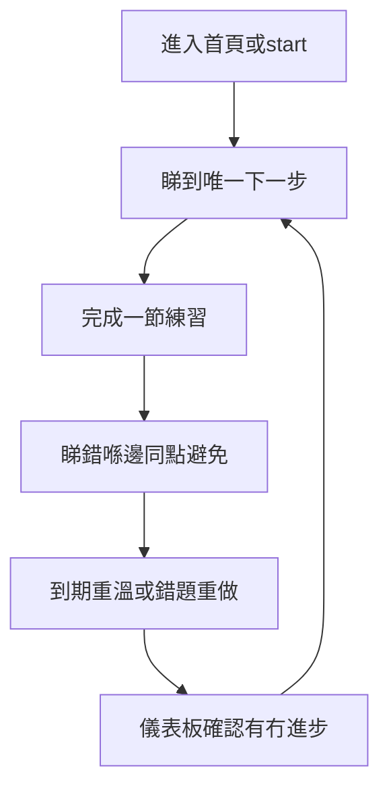

# DSE Level Up v6 Phase 2 問題定義

- **狀態：** Phase 2 完成，等待批准進入 Phase 3
- **日期：** 2026-11-04（Asia/Hong_Kong）
- **前置：** [`phase-1-research.md`](./phase-1-research.md)（基線 `95134df`；研究 commit `841e76e`）
- **方法：** 只定義問題、邊界同驗證計劃。唔改 code、唔改 schema、唔跑 migration、唔部署。
- **核心問題：**

> 學生唔係缺乏題目，而係缺乏一個能幫佢哋知道「錯喺邊、點樣修復、幾時重溫、有冇進步」嘅免費學習系統；同時平台需要足夠安全、透明、無障礙、低成本同穩定，先值得學生交付學習數據。

---

## 1. 目標用戶

以憲章目標受眾為準，按 v6 優先級分層。

### P0（必須服務）

| 用戶 | 情境 | 產品必須做到 |
|---|---|---|
| 邊緣分數考生 | 時間少、錯同一類題 | 睇到錯因、可重做、有溫柔下一步 |
| 自修生／重考生／夜校生／在職考生 | 節奏不穩、可能離線或深夜溫習 | 可暫停、可恢復、唔催逼 |
| SEN／基層／劏房／公屋／宿舍／院舍學生 | 共用裝置、共用 IP、低網速 | 登出唔洩漏、限流唔封校、Lite／無障礙可用 |
| 少數族裔／非華語學生 | 政策頁難讀 | 至少有政策摘要路徑（Phase 後段；MVP 先定義需求） |
| 未成年學生同其 `parent`／`legal_guardian` | 同意、刪除、查詢 | 可審計同意同刪除；祖父母／外傭／教師／社工無自動權 |

### P1（受益，但唔定義 MVP 完成）

- 前線老師／SENCO：內容來源同錯誤回報可見；唔做深度家長／教師監控。
- 義工審題人：審核狀態可追蹤；唔喺 Phase 2 擴建完整 CMS。

### 非目標用戶（今次唔為佢哋加功能）

- 全齡層、亞太擴張用戶（憲章禁止）。
- 需要 AI 對話導師、社群比較、付費加速嘅用戶。

---

## 2. 核心用戶旅程

v6 要收斂為**一條可完成嘅修復閉環**，而唔係更多入口。

### 現況旅程（問題所在）

1. `/` 或多個 CTA → `/start` 或 `/subjects` → `/practice` → `/result` → `/dashboard`。
2. 有課題級重溫同本機錯因，但**唔保證**「按題重做 → 通過 → 弱項下降」可證明。
3. 平行面（predictor、paper-warrior、sensei、ai 指南、relax）搶注意力。
4. 登出後本機資料仍在；學校 NAT 可能 429；未完成節雙機可被牆鐘覆蓋。

### 目標旅程（問題定義層，非實作規格）

| 步驟 | 學生應感受到 | 而家缺口 |
|---|---|---|
| 進站 | 一個下一步，唔係一堆選擇 | 入口語義分裂 |
| 練習 | 10 題左右、可暫停、唔羞辱 | 大體有；催逼風險要守住 |
| 錯後 | 錯喺邊一步、點解、下次點避免 | 解析參差；錯因未系統化上雲 |
| 重溫 | 到期可一鍵重做原錯題或同邏輯變式 | 課題抽題 ≠ 原題重做 |
| 回訪 | 睇到進步同下一動 | dashboard 密；缺可查詢修復指標 |
| 信任 | 來源、審核、私隱、刪除清楚 | PICS／刪除權／未成年同意未齊 |
| 惡劣環境 | 共用裝置、離島 4G、離線草稿仍安全 | 見 Phase 1 SEC-P1-001／004／006 |

---

## 3. 問題陳述

### 3.1 學習成效問題

學生可以做大量題，但平台難以證明：

1. 佢知唔知自己錯喺邊。
2. 重做之後有冇真係修復。
3. 3／7／14 日後仲記唔記得。
4. 下一步應該做邊一條最短路徑，而唔係再開一科目錄。

根因（Phase 1 證據）：進度係 JSON blob；錯題本機上限 200；重溫課題級；無已上線、可 checksum 嘅逐題 `mistakes`／`review_schedule`；無產品事件證明「有效修復節」。

### 3.2 信任同交付資料問題

學生（同監護人）要交出學習數據，先決條件係：

1. 保安夠（RLS、登出、限流、secret）。
2. 私隱夠（刪除權、同意、唔賣數據）。
3. 內容夠（來源、審核、可回報）。
4. 平台唔會因為遷移或離線合併搞丟進度。

根因：生產 schema／PITR 未核對；刪帳未刪 `auth.users`；未成年同意無紀錄；遷移未達零丟失條件。

### 3.3 營運韌性問題

免費平台若被共用 IP 誤傷、Storage／egress 爆、或事故無人負責，就會停服。停服對基層同離島學生殺傷最大。

根因：單機 IP 限流；無 runtime 成本 breaker；事故負責人同 RTO／RPO 未定。

### 一句產品問題

> 點樣喺唔催逼、唔收費、唔加 AI 助手、唔破壞現有進度嘅前提下，令一位香港 DSE 學生可以穩定完成「診斷弱項 → 修復 → 重溫 → 看見進步」，同時令平台值得被託付個人學習資料？

---

## 4. 成功指標

每個指標標明：**可量度性**、**基線**、**方向**。數字目標喺 Phase 3 驗證後先鎖定；Phase 2 只定「量咩」同「點樣先算有進步」。

| 指標 | 定義 | 而家可量？ | 基線 | 方向 |
|---|---|---|---|---|
| 錯題重做率 | 有錯題嘅學生中，7 日內啟動重做嘅比例 | **否**（無逐題重做事件） | 未知 | 建立事件後上升 |
| 錯題重做通過率 | 重做後首次或同日通過該題／同邏輯變式嘅比例 | **否** | 未知 | 上升；唔用截斷後 200 筆冒充全量 |
| 7 日／14 日 retention check 完成率 | 到期重溫被完成嘅比例 | **部分**（課題級本機；無雲端可信） | 未知 | 上升且唔催逼 |
| 每週學習路線完成率 | 週計劃任務完成比例 | **否**（無週路線產品） | N/A | 僅當 MVP 納入路線先量 |
| 儀表板 next-action 點擊率 | 主「下一步」被點擊／曝光 | **否**（無統一 next-action 事件） | 未知 | 上升；同時減少並列 CTA |
| 內容錯誤回報處理時間 | 收到 → 已修正／已下架中位時間 | **部分**（有 `question_reports`；處理 SLA 未制度化） | 未知 | 縮短；狀態對學生可見 |
| P0 security finding 修復時間 | 發現 → 修復或已批准 mitigation | **文件層** | Phase 1 起計 | P0 ≤ 下一個批准里程碑內關閉 |
| Critical dependency vulnerability 修復時間 | `npm audit --omit=dev` critical → 修復 | **可**（要重跑 audit） | 未跑 | critical 唔帶入 release |
| 核心 API error rate | progress／sync／consent／delete 5xx | **部分**（Sentry；無產品 SLO 儀表） | 未知 | < 1%（發布準則沿用） |
| 核心學習流程 p95 latency | 開練習 → 可作答；提交 → 解析可見 | **否**（未有正式 RUM 定義） | 未知 | 對齊 D3：INP ≤ 200 ms |
| 離線合併成功率 | 有衝突嘅同步中，零覆蓋完成節、未完成節可解釋合併 | **否** | 未知 | ≥ 95%；失敗有 log |
| 共用 IP 誤 block 率 | 已登記白名單或合理學校 NAT 被 403／永久拒 | **否**（而家係 429 限流，無封禁） | 0 封禁；429 未知 | **誤 block = 0**；429 誤傷要降 |
| 舊資料遷移丟失率 | checksum 唔夾／失踪筆數 ÷ 來源筆數 | **否**（未遷移） | N/A | **必須 = 0** 先切 read path |
| 無障礙 critical issue 數量 | axe critical；200% 橫向捲動；鍵盤斷線 | **部分**（有面板；未制度化回歸） | 未知 | critical → 0（核心流程） |
| Storage／egress 成本 | 月費同 egress | **部分**（budget-guard 靜態；runtime 無） | ≤ US$200 帽 | 唔超帽；無 breaker 唔開 Storage |
| 催逼或羞辱式體驗投訴數量 | 電郵／回報中與羞辱、斷簽焦慮相關 | **部分**（電郵；無 taxonomy） | 未知 | 唔上升；copy-guard 保持 |

### 護欄指標（唔係增長目標）

- 未審核內容外露事件 = 0（相對於現行 hidden／pending／withdrawn 規則）。
- 刪除請求 30 日達成率（D1）— 流程未建前標「未能量」。
- 黑名單誤殺宗教／LGBTQ／妥瑞／共融用語 = 0。
- 憲章成本帽觸發：`qa:budget` 必須綠。

---

## 5. Non-goals

明確擱置，避免範圍膨脹：

1. 擱置教育型 AI 助手、AI chat、AI 生成答案／題目嘅**學生 runtime**（離線出題腳本維持現狀，唔擴成站內助手）。
2. 暫緩全科模擬卷。
3. 暫緩 DSE 等級預測擴展（現有 `/predictor` 估算唔擴、未經批准唔刪）。
4. 暫緩社群（留言、互相比較、動態牆）。
5. 暫緩深度家長監控（家長只限同意／刪除／查詢自己孩子資料嘅合法流程）。
6. 暫緩複雜 gamification（新 XP、排行榜、催促 streak、火焰）。個人段位卡唔新增；拆或留另議。
7. 暫緩廣告、Paywall、用戶數據變現。
8. 暫緩重建 Auth.js／Better Auth／Stripe；暫緩新 ORM、新 UI library、新 auth provider。
9. 暫緩全站 RTL 同全語系產品化（政策摘要可後段做）。
10. 未確認 PITR 同三項 P0 之前，暫緩任何 production migration／資料搬遷。

---

## 6. Constraints

### 6.1 來自 Phase 1 已採納決定（D1–D5）

| ID | 約束摘要 |
|---|---|
| D1 | 用緊就保留；刪除請求 7 日可撤回，第 8–30 日完成刪除／匿名化；`auth.users` 一併處理；本機清除 ≠ 雲端刪除 |
| D2 | 現有用戶維持同步；13 歲以下要家長／法定監護人同意先可雲端同步；代同意只接受 `parent`／`legal_guardian`；補錄唔鎖舊進度 |
| D3 | 低端機＋離島 4G 性能目標（首頁 JS ≤ 150 KB gzip、練習互動前 ≤ 180 KB、LCP ≤ 2.5s、INP ≤ 200ms 等） |
| D4 | 先備份／PITR drill、checksum、0 丟失先切換；0030 不可假設已上線；dual-write |
| D5 | 登出清本機但保護未同步資料；NAT 只限流唔封禁；完成節 union；未完成節禁止牆鐘覆蓋 |

工作預設 S1–S5 仍待你一句確認（見第 11 節），但 Phase 2／3 驗證設計以呢啲預設為準。

### 6.2 憲章硬約束

- 永久免費、無廣告、無 Paywall。
- 戰場只係香港 DSE。
- Auth 只准 Supabase Auth Google OAuth；禁止重建 Auth.js。
- 每月技術成本 ≤ US$200。
- 題庫正本在 repo；雲端係衍生鏡像。
- 未登入唔寫長期 `dse_progress`（C1），除非另修憲章。
- Next 16 用 `proxy.ts`，禁止新建 `middleware.ts`。
- Server Action／route handler 每次重新驗證身份同資源權限。
- 唔引入學生側 LLM runtime。

### 6.3 執行約束

- 小步、可驗證、可回滾；每個 PR 一個 milestone。
- 敏感表 RLS；唔將 secret 放入 `NEXT_PUBLIC_*` 或 client bundle。
- 三項 P0（生產／staging project、部署來源、事故負責人＋PITR）未答前：**禁止** production migration、key rotation、RLS 變更、資料遷移。
- 文件同 UI 文案用繁體中文（香港用語）；code／schema 可用英文。

---

## 7. Risks

| 風險 | 嚴重度 | 對問題嘅影響 | 緩解 |
|---|---|---|---|
| 未核對生產 RLS／PITR 就設計遷移 | P0 | 可能掉學生進度 | Phase 4B 前必須答 P0；D4 |
| 把「更多題」當解法 | P1 | 加劇焦慮、唔修復弱項 | MVP 以修復閉環為界 |
| 儀表板指標羞辱學生 | P1 | 違反大愛設計 | 無排名、無「你落後」；用修復率 |
| 登出清本機掉未同步進度 | P1 | 破壞信任 | S5 強制選擇 |
| `user_id` 限流設錯桶打中正常同步 | P1 | 學校學生做唔到題 | endpoint 分桶；practice-count 維持放寬 |
| 法律頁寫實過實作 | P1 | 假承諾 | 文案同代碼同一 milestone 對齊 |
| 錯題 200 上限令指標虛高 | P1 | 以為修好，其實舊錯題被截 | 全量上雲後先報通過率 |
| 範圍膨脹到路線＋SEO＋AI | P2 | 延遲保安同私隱 | Non-goals；分 Phase |
| S2 法律意見未到就上強制同意 | P1 | 合規或排斥考生 | 13–15／16–18 維持工作預設，上線前要確認 |

詳細技術風險登記見 Phase 1 第 8 節。

---

## 8. Assumptions

以下係**待 Phase 3 驗證**嘅假設，唔係已證實事實。

| ID | 假設 | 若失敗會點 |
|---|---|---|
| A1 | 學生更需要錯題修復，而唔係更多新題 | MVP 重心改為「更好解析＋更少入口」，延後重做系統 |
| A2 | 錯因標籤（概念／題意／計算／格式／陷阱）能幫學生理解 | 改為自由短句或更少標籤 |
| A3 | 「唯一下一步」能提高回訪完成率 | 保留多入口，但要誠實標用途 |
| A4 | 透明審核狀態能提升信任 | 先做好準確性同回報 SLA，透明度做輔助 |
| A5 | 免費修復閉環本身可帶留存，唔靠 gamification | 唔引入催逼 streak |
| A6 | 離線草稿＋可暫停能減少低網速流失 | 優先靜態回落同短節，離線合併延後 |
| A7 | 共用 IP 友善限流可避免學校誤傷 | 維持寬限流，唔做封禁 |
| A8 | 溫柔文案降低焦慮 | 保持 copy-guard；唔用恥辱色同排名 |
| A9 | 現有 blob＋本機資料在 checksum 下可零丟失遷移 | 遷移永不切 read path；維持 blob |
| A10 | 學生願意為雲端同步完成年齡／同意流程 | 簡化文案；未完成同意仍可本機用 |

---

## 9. MVP boundary

MVP = **值得託付資料嘅修復閉環地基**，唔係完整「個人學習操作系統」。

### 9.1 納入 MVP（問題必須被解決到可驗證）

1. **保安地基（Milestone A 問題）：** service role 不可入 client；登出／共用裝置；限流改為唔封校；secret／dependency 掃描；生產 RLS 只讀對帳。
2. **刪除權同同意（Milestone B 問題定義）：** D1／D2 流程可描述、可審計；現有同步唔被一刀切停。上線新欄位仍要 S1／S2 同 P0 確認。
3. **錯題重做問題定義：** 學生能表達「我要重做呢條錯題／呢個錯因」；指標事件可設計。**實作同遷移**仍受 D4／PITR 阻擋。
4. **誠實下一步：** 產品層定義單一 next-action 契約（續做／到期重溫／短節練習），減少羞辱式比較。
5. **內容可信最低線：** 維持 withdrawn／pending／舉報；披露來源同機檢狀態；唔擴大未審核外露。

### 9.2 寫入問題但唔算 MVP 完成條件

- 完整每週學習路線引擎。
- 完整 mastery 0–100 產品化（可保留現有估算，唔宣稱認證）。
- 節測／限時壓力模式大改。
- DSE Knowledge Hub／AEO／GEO 全面建設。
- OpenDyslexic 以外新字體供應鏈。
- Storage 上傳同成本 breaker 全自動（無 Storage 面之前只做告警設計）。

### 9.3 明確唔入 MVP

見 Non-goals。另加：重建 Auth.js；一次過搬全部 blob 而無 dual-write。

### 9.4 MVP 完成嘅「學生句子」測試

一位學生應可以講：

> 「我知而家下一步做咩；我錯嘅可以再練；平台唔會因為我喺學校 Wi‑Fi 或共用電腦就掉我嘅進度或洩漏俾下一個人；我同監護人知點刪除同點舉報錯題。」

若講唔出，MVP 未完成。

---

## 10. Phase 3 validation plan

Phase 3 只設計低成本驗證，唔開發完整功能。建議優先驗證以下假設（完整九項假設表留待 Phase 3 文件展開）。

### 10.1 建議優先驗證嘅 3 個假設

#### H1 — 學生需要錯題復習多過純粹更多題目（對應 A1）

- **Evidence needed：** 回訪時選擇「重做錯題／到期重溫」vs「開新題」嘅比例；訪談中「最想要」排序。
- **Validation method：** staging 或小 cohort 嘅 fake-door／二選一 CTA；加匿名 analytics 事件（唔加新追蹤供應商）；5–8 段半結構訪談。
- **Minimum viable test：** dashboard／result 放兩個同等視覺權重按鈕：「重溫錯題」vs「再練新題」，記點擊；唔實作完整重做引擎。
- **Success threshold：** 有錯題紀錄嘅用戶中，「重溫錯題」點擊 ≥ 「再練新題」（或訪談 ≥ 70% 將修復排喺「更多題」之上）。
- **Failure threshold：** 「再練新題」持續顯著高於重溫，且訪談話「唔知重溫有咩用」。
- **If failed：** MVP 改為強化本節解析同下一步，延後錯題系統投入。
- **MVP？** 成功 → 納入；失敗 → 降級為 P1。
- **Cost：** S。**Security／Privacy：** 事件不可含題目全文或 email。**A11y：** 兩個 CTA 鍵盤可達、文案非羞辱。

#### H2 — 進度儀表板「唯一下一步」能令學生知道而家做咩（對應 A3）

- **Evidence needed：** next-action 曝光→點擊→開始練習嘅轉換；任務完成率。
- **Validation method：** paper prototype 或 staging-only 單一「而家做呢步」卡，藏起次要入口。
- **Minimum viable test：** 用現有 recommend／due review／continue 邏輯做一條決策樹，UI 只曝光一個主按鈕，量一週。
- **Success threshold：** 主按鈕點擊率 ≥ 現有分散 CTA 合計嘅主要行動率，或完成一節比例上升且投訴「搵唔到入口」下降。
- **Failure threshold：** 完成率下降，或學生話「俾人迫」。
- **If failed：** 保留多入口，但改文案分「練習／筆記／工具」。
- **MVP？** 成功 → 納入；失敗 → 只做文案收斂。
- **Cost：** S。**Security：** 無。**Privacy：** 決策只用本機或已同步進度。**A11y：** 單一主行動對 SEN 更友好，需測。

#### H3 — 共用 IP 友善設計能避免學校／宿舍／劏房誤傷（對應 A7）

- **Evidence needed：** 同一 IP 多 `user_id` 並發同步時 429／失敗率；誤 block 次數。
- **Validation method：** staging 模擬 30 用戶同 IP 打 progress／practice-count；對照而家 60／min IP 桶。
- **Minimum viable test：** 腳本化負載（唔打生產）；量 429；設計 `user_id` 分桶 prototype（唔部署生產）。
- **Success threshold：** 模擬學校場景下，已登入用戶正常同步失敗率 ≈ 0；誤 block = 0。
- **Failure threshold：** 分桶後仍大量 429，或安全測試顯示可輕易撞爆。
- **If failed：** 維持寬 IP 限流 + 更粗 endpoint 豁免；延後嚴格 20／min。
- **MVP？** 成功準則進入 Milestone A；失敗則 A 只做「唔封禁＋放寬」而唔收緊。
- **Cost：** S。**Security：** 防 `X-Forwarded-For` 偽造要一併驗。**Privacy：** log 唔留完整 IP 長期。**A11y：** 無直接影響。

### 10.2 其餘假設（Phase 3 文件展開，唔喺今次實作）

| 假設 | 建議最低成本驗證 |
|---|---|
| 錯因標籤有用 | 練習後抽樣 3 個標籤 vs 自由短句；睇重做正確率 |
| 每週路線提高完成率 | paper weekly plan；假門「生成本週計劃」 |
| 透明審核提升信任 | 信任頁 A／B：有／無審核狀態；問卷信任分 |
| 免費閉環帶留存 | 7／14 日回訪，對照有無重溫提醒（非催逼） |
| 離線可暫停減少流失 | 通勤用戶訪談＋離線草稿原型 |
| 溫柔文案降焦慮 | 現有 copy-guard 句子 vs 中性句；短問卷焦慮分 |

### 10.3 Phase 3 產出同暫停條件

- 產出：`docs/update-v6/phase-3-hypotheses.md`。
- 唔改生產數據、唔加新追蹤供應商、唔開 AI runtime。
- 若驗證需要新 analytics 事件：先列事件名同私隱影響，等批准先埋點。
- Phase 3 完成後再停，等「批准進入 Phase 4A」。

---

## 11. 仍然開放、會影響後期但唔阻擋 Phase 3 文件

### 請優先確認（工作預設已寫，要你一句）

1. **S1** 硬刪／不可逆匿名化 + 去識別化 aggregate？
2. **S2** 13–15 強制同意、16–18 通知加可選？（可標「等法律意見」）
3. **S3** 性能數字作 v6 release blocker（先 baseline）？
4. **S4** 舊 blob 驗證後留 90 日？
5. **S5** 未同步登出強制提示？

### P0（未答則 Phase 4B／遷移／key rotation 仍然禁止）

6. 生產同 staging Supabase project  
7. `main` 是否唯一生產來源／保護規則  
8. 事故負責人、backup／PITR、RTO、RPO  

---

## 12. Phase 2 完成清單

### 已完成項目

1. 目標用戶同核心旅程  
2. 問題陳述（學習、信任、韌性）  
3. 成功指標（含而家可量／不可量）  
4. Non-goals、Constraints（D1–D5＋憲章）、Risks、Assumptions  
5. MVP boundary  
6. Phase 3 驗證計劃同三個優先假設  

### 產出檔案

- `docs/update-v6/phase-2-problem-definition.md`

### 發現嘅風險

- 多數產品成功指標而家量唔到，若未先埋最小事件，Phase 6 會無證據。  
- MVP 若偷步做遷移，會撞上 D4／PITR 停止條件。  
- 「唯一下一步」若設計成催促，會違反大愛同 A8。  

### 未解決問題

- S1–S5、三項 P0。  
- 個人段位卡去留。  
- 舊錯題實際規模、學校 CIDR 清單。  

### 下一 Phase 建議

- 只做 Phase 3：把 H1–H3 同其餘假設寫成完整驗證卡（含 S／M／L 成本同 MVP 去留建議）。  
- 仍然唔改 code，除非你另批「允許 staging 埋點／假門」。  

### 需要你確認嘅決策

- 第 11 節。  
- 是否同意 MVP = 保安＋私隱同意／刪除問題＋錯題重做問題定義＋誠實下一步（第 9 節）。  
- 是否同意優先驗證 H1、H2、H3。  

### 建議優先驗證嘅 3 個假設

1. **H1** 錯題復習需求 ≥ 更多新題  
2. **H2** 唯一下一步能降低「唔知做咩」  
3. **H3** 共用 IP 友善限流可避免學校誤傷  

**Phase 2 完成，等待批准。**
