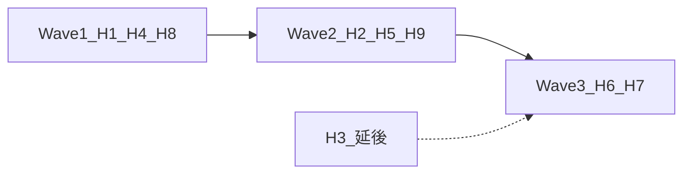

# DSE Level Up v6 Phase 3 假設驗證設計

- **狀態：** Phase 3 完成，等待批准進入 Phase 4A
- **日期：** 2026-11-04（Asia/Hong_Kong）
- **前置：** [`phase-1-research.md`](./phase-1-research.md)、[`phase-2-problem-definition.md`](./phase-2-problem-definition.md)
- **方法：** 只設計低成本驗證。**唔**開發完整功能、**唔**改生產資料、**唔**加新追蹤供應商、**唔**開 AI runtime。
- **埋點規則：** 若測試需要 analytics 事件，本文件只列事件名同私隱影響；要另批「允許 staging 埋點／假門」先可實作。
- **約束：** D1–D5；三項 P0 未答前禁止 production migration／key rotation／RLS 變更／資料遷移。

---

## 0. 總覽：邊啲假設入 MVP、邊啲延後

| ID | 假設（短） | 建議優先 | 建議 MVP | 成本 |
|---|---|---|---|---|
| H1 | 錯題復習 > 更多新題 | P0 先驗 | **納入**（成功則做；失敗則降級） | S |
| H2 | 錯因標籤幫理解 | P1 | **納入精簡版**（2–3 標籤先） | S |
| H3 | 每週學習路線提高完成率 | P2 | **延後**（問題可寫；引擎唔入 MVP） | M |
| H4 | 儀表板下一步令學生知做咩 | P0 先驗 | **納入** | S |
| H5 | 透明審核提升信任 | P1 | **納入最低披露** | S |
| H6 | 免費核心閉環帶留存 | P1 | **納入量度**；唔靠 gamification | M |
| H7 | 離線可用＋可暫停減少流失 | P1 | **納入暫停／草稿問題**；完整 SW 合併可後段 | M |
| H8 | 共用 IP 友善避免誤 block | P0 先驗 | **納入 Milestone A 準則** | S |
| H9 | 溫柔、無羞辱介面降焦慮、提高回訪 | P1 | **納入護欄**（copy-guard／無排名） | S |

**建議納入 MVP 嘅假設：** H1、H2（精簡）、H4、H5（最低披露）、H6（只建量度）、H8、H9。  
**建議延後：** H3（完整週路線引擎）；H7 嘅完整離線 operation log（可先做可暫停同靜態回落；合併設計等 Phase 4B）。

保安地基、刪除權、同意邊界係 Phase 2 MVP 硬需求，**唔靠呢九項假設否決**；假設失敗只調整學習功能範圍。

---

## 1. 共用驗證守則

1. **樣本：** 小 cohort（建議 8–20 位願意幫手嘅考生／自修生），或 staging 模擬。唔好一開始全站實驗。
2. **文案：** 過 `copy-guard` 精神——無「你又衰」「落後」「失敗者」；無大面積處罰紅。
3. **私隱：** 事件只可有匿名／偽匿名 id、科目、action name、timestamp。禁止題目全文、email、精確學校名、長期原始 IP。
4. **催逼：** 重溫提醒必須可關閉；唔設斷簽火焰。
5. **共用裝置：** 任何 staging UI 測試後要清本機或用訪客模式（對齊 D5／S5）。
6. **停止：** 若測試需要寫生產 DB 或新 SDK，停止並請批准。

### 建議事件名（未批准埋點前只係清單）

| 事件 | 用途 | 資料欄位（上限） |
|---|---|---|
| `cta_review_mistakes_click` | H1 | subject?, has_local_mistakes:bool |
| `cta_new_practice_click` | H1 | subject? |
| `error_tag_selected` | H2 | tag_id, question_id_hash |
| `weekly_plan_fake_door` | H3 | source:result\|dashboard |
| `next_action_impression` | H4 | action_type |
| `next_action_click` | H4 | action_type |
| `trust_panel_view` | H5 | variant:a\|b |
| `session_completed` | H6 | subject, size |
| `return_day_n` | H6 | n:7\|14 |
| `offline_draft_save` | H7 | draft_bytes_bucket |
| `rate_limit_429` | H8 | route_class, auth:bool |
| `copy_anxiety_survey` | H9 | score:1-5, variant |

---

## 2. 假設卡

### H1 — 學生需要錯題復習多過純粹更多題目

- **Hypothesis：** 有錯過題嘅學生，回訪時更傾向選擇「重溫／重做錯題」，而唔係「再開一堆新題」。
- **Evidence needed：** CTA 點擊比；訪談排序；有錯題 vs 無錯題分層。
- **Validation method：** fake-door／二選一 CTA；5–8 段半結構訪談；可選 staging-only。
- **Minimum viable test：** 喺 `/result` 或 `/dashboard` 放兩個同等權重按鈕：「重溫錯題」vs「再練新題」。重溫可暫時導去現有課題重溫或「即將推出」誠實頁。量 7 日。
- **Success threshold：** 有本機／雲端錯題訊號嘅用戶中，重溫 CTA ≥ 新題 CTA；或訪談 ≥ 70% 將「修復舊錯」排喺「更多新題」之上。
- **Failure threshold：** 新題 CTA 連續高於重溫，且訪談話重溫「無用／唔知點用」。
- **If failed, what changes：** MVP 重心改為本節解析質素＋誠實下一步；錯題引擎降為 P1。
- **Whether it enters MVP：** **係**（成功則做問題定義對應功能；失敗則縮小）。
- **Implementation cost：** S
- **Security impact：** 低。假門唔好暴露其他用戶錯題。
- **Data privacy impact：** 低。事件唔含題幹。
- **Accessibility impact：** 中。雙 CTA 要鍵盤可達、焦點清晰、文案非羞辱。
- **Cost impact：** 可忽略（無新後端）。

### H2 — 錯因標籤能幫學生理解錯誤

- **Hypothesis：** 喺答錯後提供少量固定錯因標籤（概念、題意理解、計算／符號、單位／格式、陷阱邏輯），學生較易講出「下次點避免」，重做正確率較高。
- **Evidence needed：** 標籤選用分布；選標籤後重做通過率 vs 無標籤；學生能否覆述錯因。
- **Validation method：** 小 cohort 練習後抽樣；A：3 個標籤；B：自由短句；C：無。
- **Minimum viable test：** 只喺 1 科（建議數學或英文）答錯後顯示 3 個標籤＋「其他」；唔改分數邏輯。24–48 小時後請同一批人重做最多 5 題。
- **Success threshold：** 有標籤組嘅學生能正確覆述自己標籤 ≥ 60%；或重做通過率比無標籤組高 ≥ 10 個百分點（小樣本只作方向，唔作統計宣稱）。
- **Failure threshold：** 標籤被亂撳、學生話「唔知分別」、通過率無差或更差。
- **If failed, what changes：** 改為解析內固定「常見錯因」文案，唔強制學生自標；或減到 2 類（概念 vs 粗心）。
- **Whether it enters MVP：** **精簡納入**（2–3 標籤＋可跳過）。完整五標籤同雲端錯因表可後段。
- **Implementation cost：** S（UI 試驗）；全量上雲 M
- **Security impact：** 低。
- **Data privacy impact：** 中。若上雲要進同意範圍；試驗優先本機。
- **Accessibility impact：** 中。標籤要用文字，唔好只用色；可跳過。
- **Cost impact：** 本機試驗可忽略；上雲列數要估算（D4）。

### H3 — 每週學習路線能提高完成率

- **Hypothesis：** 「本週 3–5 次、每次 15–30 分鐘」嘅明確路線，比自己喺科目目錄揀題，有更高週完成率。
- **Evidence needed：** 假門點擊；紙本一週打卡完成次數；訪談意願。
- **Validation method：** paper prototype（一頁週曆）＋ fake-door「生成本週計劃」按鈕。
- **Minimum viable test：** dashboard 放「生成本週計劃」；點擊後顯示靜態範例計劃（非演算法），問「若有真計劃你會唔會跟」。連做 1 週紙本追蹤（自願）。
- **Success threshold：** 假門點擊佔 dashboard 活躍用戶 ≥ 25%；紙本志願者中 ≥ 50% 完成 ≥ 3 次／週。
- **Failure threshold：** 點擊 < 10%，或學生話「多一樣壓力」。
- **If failed, what changes：** 唔做週引擎；改為單次 next-action（H4）同錯題重溫（H1）。
- **Whether it enters MVP：** **延後**。Phase 2 已列為非 MVP 完成條件。
- **Implementation cost：** 驗證 S；真引擎 M–L
- **Security impact：** 低。
- **Data privacy impact：** 低（假門）；真計劃上雲要同意。
- **Accessibility impact：** 高風險若做成待辦壓力——必須可調節奏、可暫停、無落後羞辱。
- **Cost impact：** 真引擎可能加表同讀寫；延後有助守 US$200。

### H4 — 進度儀表板能令學生知道下一步

- **Hypothesis：** 單一「而家做呢步」主行動，能提高「知做咩 → 開始練習」轉換，並降低入口迷失。
- **Evidence needed：** impression→click→session_start；完成一節比例；「搵唔到」投訴。
- **Validation method：** staging-only 或小 cohort UI：只曝光一個主按鈕；次要入口收埋或降權。
- **Minimum viable test：** 用現有 continue／due review／quickStart 做決策樹（偽代碼即可），UI 一週只推一個主 CTA。
- **Success threshold：** 主 CTA 轉換 ≥ 現況分散主行動合計；或完成一節比例上升，同時無「被催」投訴上升。
- **Failure threshold：** 完成率下降，或訪談話「好似被逼」。
- **If failed, what changes：** 保留多入口，但分「練習／筆記／工具」標籤；唔強行單一按鈕。
- **Whether it enters MVP：** **係**。
- **Implementation cost：** S
- **Security impact：** 無。
- **Data privacy impact：** 低；決策用本機或已同步進度。
- **Accessibility impact：** 正面傾向（單一主行動）；需測螢幕閱讀器同焦點順序。
- **Cost impact：** 可忽略。

### H5 — 透明審核狀態會提升信任

- **Hypothesis：** 清楚顯示題目來源類別、審核／待核／已修正狀態，會提高「願意繼續用／願意登入同步」嘅信任分。
- **Evidence needed：** 信任問卷（1–5）；登入／同意同步意願；舉報行為有否因透明而更理性（非濫報）。
- **Validation method：** 信任／transparency 頁或練習頁 provenance A／B：A 現況；B 加強「待核／已審／來源」說明。
- **Minimum viable test：** 靜態文案變體＋10–15 份短問卷；唔改題庫閘。
- **Success threshold：** B 組平均信任分高 ≥ 0.5（5 分制），或「願意同步」比例更高；同時舉報量唔爆炸。
- **Failure threshold：** 信任無差，或學生因「待核」而唔敢做題。
- **If failed, what changes：** 維持機檢披露；把力氣放喺回報 SLA 同修正速度，而唔係更多徽章。
- **Whether it enters MVP：** **最低披露納入**（沿用 provenance＋舉報狀態）；完整 provenance CMS 延後。
- **Implementation cost：** S（文案／UI）；完整審核工作流 M
- **Security impact：** 唔好暴露內部 reviewer 個人資料超出必要。
- **Data privacy impact：** 低。
- **Accessibility impact：** 狀態要用文字，唔好只靠色點。
- **Cost impact：** 低。

### H6 — 免費核心閉環可帶來留存

- **Hypothesis：** 即使無 gamification／Paywall，完成「練習→解析→重溫／下一步」閉環嘅學生，7／14 日回訪會高過只瀏覽科目頁嘅學生。
- **Evidence needed：** 7／14 日回訪；閉環完成次數；對照組。
- **Validation method：** 用現有匿名 `practice_counts`＋（若批准）最小事件；回顧性分析＋小 cohort 前瞻。
- **Minimum viable test：** 定義「閉環完成」= 完成一節且睇過解析或點過下一步。量兩週回訪。唔加 streak。
- **Success threshold：** 閉環組 7 日回訪顯著高於只瀏覽組（方向性即可）；投訴催逼 = 0。
- **Failure threshold：** 無差，或只有加提醒／徽章先有回訪——唔可因此引入催逼 streak。
- **If failed, what changes：** 留存改靠內容質素同 SEN 友善，而唔係閉環儀表；檢討解析是否太長。
- **Whether it enters MVP：** **量度納入**；唔把「留存上升」當成可加 gamification 嘅許可。
- **Implementation cost：** 驗證 M（要事件）；產品唔加新激勵 S
- **Security impact：** 低。
- **Data privacy impact：** 中。回訪事件要聚合；注意未成年。
- **Accessibility impact：** 提醒必須可關（D3／SEN）。
- **Cost impact：** 低；避免新分析 SaaS。

### H7 — 離線可用與可暫停設計能減少低網速或通勤學生流失

- **Hypothesis：** 可暫停、可存草稿、斷線唔掉已答題，能降低離島／通勤／內地網絡學生嘅中途離開。
- **Evidence needed：** 弱網下完成率；草稿恢復成功；訪談。
- **Validation method：** 面試通勤／宿舍學生；staging 開 Chrome throttling；可選離線草稿原型（本機 only）。
- **Minimum viable test：** （1）現況：飛行模式中途離開再回來，記失分點；（2）紙本／原型：「暫停」按鈕預期行為問卷。
- **Success threshold：** ≥ 70% 受訪者話「可暫停／斷線恢復」會令佢哋更願意喺路上練；原型下已答題唔消失。
- **Failure threshold：** 學生更在意題質同流量，唔在意離線；或草稿令共用裝置殘留惡化。
- **If failed, what changes：** 優先靜態題庫回落＋短節（10 題）；完整 SW／operation log 延後。
- **Whether it enters MVP：** **可暫停／唔掉本節答案** 納入問題；**完整離線合併** 跟 D5，設計在 4B，實作可後段。
- **Implementation cost：** 驗證 S；完整離線 M–L
- **Security impact：** 高相關——草稿必須跟登出清除（D5）。
- **Data privacy impact：** 本機草稿可能含學習弱項；共用裝置要清。
- **Accessibility impact：** 暫停對 SEN／焦慮友善。
- **Cost impact：** SW 快取要防 egress 同舊 cache 洩漏。

### H8 — 共用 IP 友善設計能避免學校、宿舍、劏房或家庭用戶被誤 block

- **Hypothesis：** 以 `user_id` 分桶、IP 只限流唔封禁、學校 CIDR 白名單只 log，可令同 NAT 多用戶同時練習而不出現誤封或不可接受嘅 429。
- **Evidence needed：** 同 IP 多用戶並發下嘅 429 率、失敗率、誤 block 次數（目標 0）。
- **Validation method：** 非生產環境負載腳本；對照現況 60／min／IP；prototype `user_id` 桶。
- **Minimum viable test：** 模擬 30 個已登入身份、同一 IP，對 `progress`／`practice-count`／`sync/session` 打真實路徑形狀（可 mock handler）。量 429。另測偽造 `X-Forwarded-For`。
- **Success threshold：** 學校場景正常同步失敗 ≈ 0；誤 block = 0；偽造轉發頭唔能無限擴桶。
- **Failure threshold：** 分桶後仍大量 429，或安全上可被撞爆。
- **If failed, what changes：** Milestone A 只保證「唔封禁＋維持／擴大學校友善豁免」，延後收緊到 20／min。
- **Whether it enters MVP：** **係**（作為保安／韌性準則，唔係「功能賣點」）。
- **Implementation cost：** S
- **Security impact：** 高。限流係攻擊面；白名單要人工審批（D5）。
- **Data privacy impact：** 中。IP 只短留；白名單含機構名要最小權限。
- **Accessibility impact：** 間接——基層學生先受惠。
- **Cost impact：** 維持記憶體限流則低；若改 Redis 要另批（超預算風險）。

### H9 — 溫柔、無羞辱式介面能降低焦慮並提高回訪

- **Hypothesis：** 非羞辱文案、無排名、可關倒數壓力，會令焦慮自評下降，並提高自願回訪。
- **Evidence needed：** 短焦慮量表（練習前後）；回訪；copy-guard 違規 = 0。
- **Validation method：** 文案 A／B（現有溫柔句 vs 中性句）；關閉倒數 vs 開倒數（可選）；訪談。
- **Minimum viable test：** 10 位學生做同一節；一半見現有鼓勵句，一半見純中性句；測後 1–5 焦慮同「會唔會返嚟」。唔引入羞辱對照組（倫理上禁止故意羞辱學生）。
- **Success threshold：** 溫柔組焦慮分唔高過中性組，回訪意願 ≥ 中性組；零羞辱投訴。
- **Failure threshold：** 溫柔文案被覺得「假／幼稚」且回訪意願更低——則改為簡潔中性，仍然禁止羞辱。
- **If failed, what changes：** 收斂為短中性書面語；保持無排名、無斷簽。
- **Whether it enters MVP：** **護欄納入**（唔係可選實驗功能）。
- **Implementation cost：** S
- **Security impact：** 無。
- **Data privacy impact：** 問卷儘量匿名。
- **Accessibility impact：** 高——關倒數、減動、SEN 模式要一併可用。
- **Cost impact：** 無。

---

## 3. 驗證時序（建議，非日曆承諾）

1. **Wave 1（先做，成本 S，擋 MVP 形狀）：** H1、H4、H8  
2. **Wave 2（學習同信任質感）：** H2、H5、H9  
3. **Wave 3（留存同離線，要更多準備）：** H6、H7  
4. **延後：** H3 真引擎；H7 完整 operation log 實作  

Wave 1 結果應喺進入 Phase 5 Milestone E 前書面記錄。唔要求等齊九項先開 Phase 4A 設計，但 **H1／H4／H8 未有方向性結果前，唔好鎖死大實作**。

---

## 4. 建議納入 MVP vs 延後（決策摘要）

### 納入 MVP

| 假設 | 納入形式 |
|---|---|
| H1 | 錯題重做／重溫作為核心問題同假門驗證後嘅功能優先 |
| H2 | 可跳過嘅精簡錯因（2–3 類） |
| H4 | 單一 next-action 契約 |
| H5 | provenance＋舉報狀態可見 |
| H6 | 只建閉環／回訪量度，唔加遊戲化 |
| H8 | Milestone A 限流同誤 block=0 準則 |
| H9 | copy-guard、無排名、可關壓力提示 |

### 延後

| 假設 | 原因 |
|---|---|
| H3 完整週路線引擎 | Phase 2 非 MVP；假門先；防催逼同成本 |
| H7 完整離線 operation log／PWA | 要 D5 設計＋共用裝置清除；可先暫停同靜態回落 |
| H2 五標籤＋雲端全量 | 等 H2 試驗同 D4 |
| H5 完整雙審 CMS | 最低披露先；改機器閘要修憲章 |

### 唔因假設失敗而放棄

- Milestone A 保安地基  
- D1 刪除權／D2 同意（法律同信任底線）  
- 免費、無廣告、無 AI 學生 runtime、無 Paywall  

---

## 5. 訪談腳本（共用，可剪裁）

目標：15 分鐘。對象：DSE 考生／自修生。錄音要口頭同意。

1. 你而家主要點溫習 DSE？用邊啲免費資源？  
2. 上次做題答錯，你通常下一步會做咩？  
3. 若 App 俾你揀「重溫上次錯題」或「再做 10 題新題」，你揀邊個？點解？  
4. 你點知自己有冇進步？  
5. 喺學校 Wi‑Fi／宿舍／共用電腦用過網上練習嗎？遇過被踢、登入奇怪、被人見到進度嗎？  
6. 倒數計時、連續打卡、排行榜會令你點？  
7. 你會介意題目寫住「待核／機檢」嗎？  
8. （收尾）若只可以加一樣功能，你最想要咩？  

禁止問法：暗示學生「差」「落後」；禁止收集學校全名以外唔必要嘅識別資料。

---

## 6. Phase 3 完成清單

### 已完成項目

1. 九項假設完整驗證卡（字段齊）  
2. MVP 納入／延後建議  
3. Wave 1–3 時序  
4. 事件清單（待批准先埋點）  
5. 共用訪談腳本  

### 產出檔案

- `docs/update-v6/phase-3-hypotheses.md`

### 發現嘅風險

- 未批准埋點前，H1／H4／H6 只能靠訪談同手動記數，樣本易偏。  
- H3 假門若文案過似正式功能，會製造期望債務。  
- H7 草稿試驗可能加重共用裝置洩漏（要跟 D5）。  
- H8 喺無 staging 環境時只能做本地／模擬，外推有限。  

### 未解決問題

- S1–S5、三項 P0。  
- 是否批准 staging 假門同最小事件埋點。  
- 小 cohort 招募渠道（學校？公開自願？）。  

### 下一 Phase 建議

- **Phase 4A：產品設計**（錯題復習、路線、儀表板、節測、內容透明、SEN）——設計文件，唔實作。  
- Wave 1 驗證可同 4A 平行啟動，但要另批埋點／假門。  
- 仍然唔開 Phase 4B，直至三項 P0 有答。  

### 需要你確認嘅決策

1. 是否批准 **Wave 1**（H1／H4／H8）喺 staging 做假門／模擬（仍唔改生產）？  
2. 是否批准第 1 節事件清單嘅**最小埋點**（唔加新分析供應商）？  
3. 是否確認 **H3 真引擎延後**、**H7 完整離線合併延後**？  
4. 小 cohort 由邊度招募？  

### 建議納入 MVP 嘅假設

H1、H2（精簡）、H4、H5（最低披露）、H6（量度）、H8、H9  

### 建議延後嘅假設

H3（完整週路線）；H7（完整離線 operation log／PWA，可保留暫停同靜態回落）；H2／H5 嘅完整後端工作流  

**Phase 3 完成，等待批准。**
