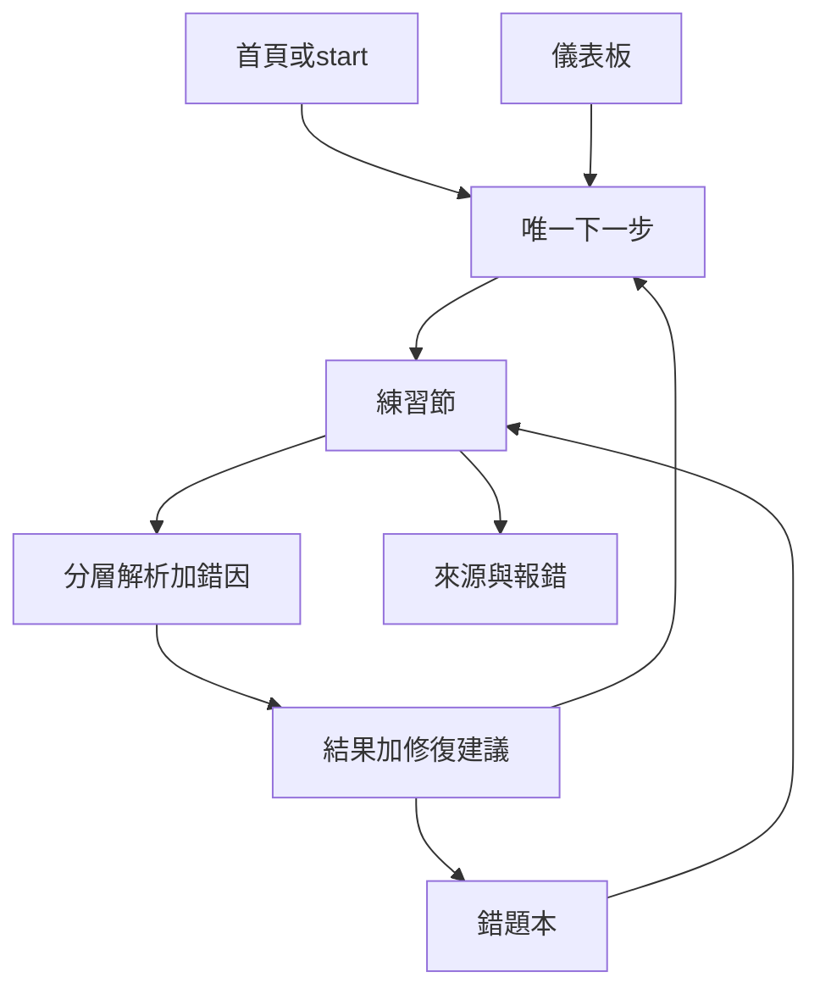

# DSE Level Up v6 Phase 4A 產品設計

- **狀態：** Phase 4A 完成，等待批准進入 Phase 4B
- **日期：** 2026-11-04（Asia/Hong_Kong）
- **前置：** Phase 1–3；憲章；現有 `PracticeSession`、`reverseLog`、`reviewSchedule`、`recommendNext`、`QuestionProvenance`、`A11yPanel`
- **方法：** 只做產品設計。**唔**改 code、**唔**改 schema、**唔**遷移資料。
- **原則：** 每一個畫面先問——係咪幫學生提高理解、修復弱項、減少重複犯錯、減輕焦慮、或節省溫習時間？唔明確就唔做。
- **MVP 對齊：** Phase 2／3——納入錯題修復、精簡錯因、唯一下一步、最低內容披露、暫停／草稿問題、SEN 護欄。完整週路線引擎同完整離線合併：**設計寫齊，實作延後**（標「延後」）。

---

## 0. 設計總覽

### 0.1 產品承諾（學生句子）

> 「我知下一步做咩；我錯嘅可以重做並睇到有冇修好；平台唔催我、唔羞辱我；來源同報錯清楚；字體同壓力提示我可以調。」

### 0.2 資訊架構（收斂，唔加平行產品）

| 表面 | 路線 | 角色 |
|---|---|---|
| 練習引擎 | `/practice` | 唯一答題場所 |
| 結果 | `/result` | 本節結算＋下一步 |
| 儀表板 | `/dashboard` | 進步、到期、下一步（手機頂部只留一件事） |
| 錯題本 | `/dashboard` 區塊或 `/mistakes`（若實作獨立路由） | 篩選、重做、通過率 |
| 科目目錄 | `/subjects` | 揀科；唔再同「練習」語義打架 |
| 信任 | provenance 元件＋`/transparency`／未來 Security & Privacy | 來源、審核、報錯 |
| 延後支線 | `/predictor`、`/paper-warrior`、`/sensei`、`/ai/*` | 唔擴；入口降權或不放 next-action |

### 0.3 文案同情緒護欄（全設計強制）

- 禁用：落後、廢、又衰、失敗者、斷簽羞辱、同儕排名百分比。
- 錯題用「再諗下／發現盲點／下次可以點」；避免大面積處罰紅。
- 倒數、重溫到期：**可關閉**；關閉後用靜態「建議時段」而非焦慮倒數。
- 連續答錯：提供「休息」「易一點」「重溫概念」三選一，唔自動加壓力。

### 0.4 現況對照（設計起點，唔當已完成）

| 能力 | 而家 | 4A 目標 |
|---|---|---|
| 錯題 | `dse_reverse_log` CAP 200；cause A／B／C（概念／審題／運算）可選 | 可按題重做；精簡錯因；3／7／14 日；通過率；舊資料可遷移（D4） |
| 重溫 | 課題級 `dueReviews`，註明唔重播原題 | MVP：原題或同邏輯變式可重做；課題操練作回落 |
| 下一步 | `recommendNext`／`resultNextSteps`／多 CTA | 單一 next-action 契約 |
| Mastery | `lib/mastery.ts` 等級區間估算 | 儀表板用 0–100 **修復導向**分數；唔宣稱官方等級 |
| Provenance | 機檢／待核＋舉報 | 來源類別、狀態機、回報追蹤（最低披露先） |
| SEN | `A11yPanel` 齊 | 設計確認必開項；OpenDyslexic 已有則保留 |

---

## 1. 錯題復習系統

### 1.1 目標

令學生完成：**發現錯 → 標錯因 → 到期重做 → 通過則降弱項風險 → 未通過則降階練習**，而且舊紀錄唔會因為 CAP 200 或遷移而失踪（遷移細節屬 4B／D4）。

### 1.2 一鍵重做錯題

**入口**

1. `/result`：「重做今節錯題」（只含本節 `questionId`）。
2. 儀表板 next-action：若有到期重溫，主按鈕＝「重溫到期錯題」。
3. 錯題本：篩選後「重做已選／重做全部可見」。

**行為**

- 開 `/practice` 新 mode：`mode=mistakes`（或同等 query），參數帶 `ids=` 或 `source=session|due|filter`。
- 預設一節上限同 `SESSION_SIZE`（而家 10）對齊；少過 10 就做晒為止。
- 計分：重做通過＝該題本次正確；**唔用**重做分覆蓋歷史首次對錯（保留學習史）。首次錯仍然留在錯題本，直到「修復條件」達成。
- 未登入：可用本機錯題本（受 C1：關閉分頁可能冇長期 attempts；錯題 log 而家喺 localStorage——設計上登出／共用裝置要跟 D5 清或提示）。

**回落**

- 若原題已 withdrawn／pending／hidden：提示「呢題已更新或暫時唔練習」，改推同 `topicId`＋相近難度嘅題；唔默默略過而無說明。

### 1.3 錯因標籤

**對照現況**

| 現況 `ReverseCause` | 含義（歷史） | v6 標籤 |
|---|---|---|
| A | 概念盲區 | `concept` 概念 |
| B | 審題陷阱 | `trap` 陷阱邏輯（兼題意） |
| C | 運算粗心 | `calculation` 計算／符號 |

**v6 完整集合（產品詞彙）**

1. `concept` — 概念  
2. `comprehension` — 題意理解  
3. `calculation` — 計算／符號  
4. `format` — 單位／格式  
5. `trap` — 陷阱邏輯  

**MVP（H2 精簡）**

- 先暴露 **3 個＋可跳過**：`concept`｜`comprehension`｜`calculation`；`format`／`trap` 可併入說明或放「其他」。
- 答錯後出現；**可跳過**（唔鎖死 30 秒——自診鎖已暫停，唔復活催逼鎖）。
- 選擇寫入錯題紀錄；解析區顯示「你標嘅方向」＋「題目常見陷阱」（若有 `optionNotes`／未來 trap 欄）。
- 舊 A／B／C：**唯讀映射**到新枚舉（A→concept，B→comprehension 或 trap，C→calculation），遷移時保留原值＋新值（4B）。

### 1.4 每題三層「錯喺邊」

答錯或重做檢討時，固定三塊（對齊現有 `StagedExplanation`，唔一開始攤開）：

1. **錯喺邊一步** — 最短一句，指關鍵步驟／選項分歧。  
2. **點解錯** — 概念或陷阱說明（書面語／英文按科）。  
3. **下次點避免** — 可執行檢查清單（1–3 點）。  

若題目缺 `steps[]`：唔好假切散文；顯示完整解析＋「待補步驟」內部旗標（內容流程，唔責備學生）。

### 1.5 Spaced repetition：3／7／14 日

**對照：** 而家 `INTERVALS = [1,3,7,14,30]` 課題級。

**v6 設計**

| 階段 | 日程 | 觸發 |
|---|---|---|
| 初錯 | +3 日 | 記入 `review_items`（邏輯實體；儲存 4B） |
| 再溫 | +7 日 | 若 3 日未做或未過 |
| 鞏固 | +14 日 | 7 日通過後排 |
| 可選長尾 | +30 日 | 延後；與現況兼容但不做主推焦慮 |

- **MVP 日曆：** 對外主打 3／7／14；1 日同 30 日可作內部相容，唔做「你斷咗簽」。
- 到期定義：`due_at <= today`（學生時區預設 Asia／Hong_Kong；海外考生用瀏覽器時區，4B 定）。
- 每日展示上限維持溫柔：`DAILY_REVIEW_LIMIT` 精神（而家 5）；可設定「今日最多 N 條」，預設 5。
- 提醒：儀表板靜態「有 N 條到期」；推送若用 exam-day 基建，必須 opt-in，可關。

### 1.6 通過後降弱項；未通過則降階

**修復通過（pass）條件（設計）**

- 同 `questionId` 重做正確；或  
- 標明嘅同邏輯變式（`question_variants`／同 topic＋同錯因標籤池）正確一次。  

**效果**

- 該項弱項風險下降（儀表板 weak topics 權重降）。  
- 排程改為更長間隔或標記 `repaired_at`。  
- **唔**彈「升級」「段位暴擊」式慶祝到羞恥對照。

**未通過**

- 提供：「易一點同概念」「同邏輯變式」「先睇一句提示再試」。  
- 間隔縮短（例如退回 +3 日），文案：「再練一次會更穩」，禁用「又錯」。

### 1.7 篩選同通過率

錯題本篩選：科目、課題、錯因、難度、重溫到期日（已到期／3 日內／已修復）。

顯示：

- 重做通過率 = 通過次數 ÷ 重做啟動次數（分母≥1 先顯示；細樣本加「參考」）。  
- **禁止**用 CAP 200 截斷後嘅本機 log 冒充終身通過率（H1／D4）。雲端全量可用前，UI 寫「近 N 條紀錄」。

### 1.8 舊錯題資料

- 產品要求：**零丟失**可見史。  
- 本機 200 CAP：顯示層可只列最近 200；伺服器全量係 4B／D4。  
- 遷移前：錯題本繼續讀 `dse_reverse_log`＋雲端 blob 內合併結果。  
- 一鍵重做必須用穩定 `questionId`；無 `topicId` 嘅舊列：回落科目級（現況已有）。

### 1.9 MVP vs 延後

| 項目 | MVP | 延後 |
|---|---|---|
| 本節錯題一鍵重做 | 是 | |
| 到期清單重做 | 是（可先課題＋原題混合，UI 誠實） | 純變式推薦引擎 |
| 3 錯因＋跳過 | 是 | 五標籤強制 |
| 3／7／14 | 是 | 完整 SM-2／30 日產品化 |
| 通過率 | 是（標近 N 條） | 終身雲端率 |
| 變式圖 | 設計保留 | 資料模型 4B 後 |

---

## 2. 學習路線

### 2.1 定位

幫學生用短節、可暫停嘅節奏覆蓋「基礎 → 強化 → 模擬感練習 → 考前溫習」，**弱項優先**，唔製造落後感。

**H3 結論：** 完整每週引擎 **延後實作**；4A 仍定產品形狀，方便假門同日後開工。

### 2.2 入門診斷

- **可選** 10 題摸底（非認證、非預測等級）。  
- 結果：Top 弱項課題（最多 3）＋建議第一週焦點一句。  
- 文案：「摸底幫排先後，唔係定終身能力。」  
- 跳過：直接用科目目錄或 next-action。  
- **唔**接去 `/predictor` 官方感等級。

### 2.3 每週 3 至 5 次、每次 15 至 30 分鐘

- 預設建議：每週 4 次 × 約 15 分鐘（10 題節奏）。  
- 學生可調：3／4／5 次；單節 5 或 10 題（對齊 JustOne／`SESSION_SIZE`）。  
- 進度條表示「本週已完成次數／自訂目標」；**唔到目標唔變紅、唔扣分**。  
- 休息日：沿用 `RestDayPicker` 精神——休息係合法狀態。

### 2.4 科目路線階段

| 階段 | 目的 | 練習組成 |
|---|---|---|
| 基礎 | 補概念洞 | 易／中、錯因 concept 多 |
| 強化 | 針對弱項 | 弱題＋變式 |
| 模擬感 | 混合限時（可關壓力 UI） | 見第 4 節；**非**全科正式 mock |
| 考前溫習 | 到期重溫＋高錯因 | 3／7／14 隊列 |

階段係**建議標籤**，學生可手動留喺基礎，系統唔自動責備。

### 2.5 Session 目標同 1 分鐘覆盤

每次開始顯示一句目標例：「今日集中：二次方程式判別式常見陷阱」。

結束 1 分鐘覆盤（`/result` 內）：

1. 今日修好／發現嘅一點（非羞辱）。  
2. 是否加入重溫。  
3. 下一次建議（next-action）。  

### 2.6 暫停、離線草稿、調整節奏

- **暫停：** 練習中可暫停；已答保留；返回同一節。  
- **離線草稿：** 本機保存未完成節（H7）；上線合併規則 4B／D5（禁止牆鐘覆蓋未完成節）。  
- **調整節奏：** 隨時改每週次數；文案「改節奏唔等於放棄」。

### 2.7 MVP vs 延後

| 項目 | MVP | 延後 |
|---|---|---|
| 可選摸底 10 題 | 設計＋可小實作 | 跨科自適診斷 |
| 每週計劃引擎 | 假門／靜態範例 | 真演算法 |
| Session 目標句 | 是（規則／題庫欄） | AI 生成（禁止） |
| 暫停 | 是 | |
| 完整週曆 gamification | 否 | 永不做催逼版 |

---

## 3. 進度儀表板

### 3.1 手機優先佈局

1. **唯一下一步**（全寬主按鈕）  
2. 到期重溫數量（可點入錯題本）  
3. 本週節奏（若未做週引擎：隱藏或顯示靜態「建議本週練 3–5 次」）  
4. 以下摺疊或次屏：mastery、趨勢、弱項、月度摘要  

桌面可雙欄，但主行動仍然只有一個視覺權重最高嘅按鈕。

### 3.2 Next best action 契約

優先序（設計）：

1. 有未完成節 → 「繼續上次」  
2. 有到期重溫 → 「重溫到期」  
3. 有本節剛錯且未重做 → 「重做剛先錯題」  
4. 否則 → `recommendNextPractice`／QuickStart 短節  
5. 若學生開休息日 → 「休息都 OK」＋可選輕量呼吸（`/relax` 降權連結，非主按鈕）

曝光同點擊對應 Phase 3 事件 `next_action_*`（待批埋點）。

### 3.3 Mastery 0–100（修復導向）

- 每科一個 0–100 **練習掌握估計**，計算可沿用／演化 `lib/mastery.ts` 校正分，但 UI **唔**主打 5** 預測。  
- 副文案：「根據你喺本站練習估計，唔係考評局等級。」  
- 樣本不足（&lt; `MIN_QUESTIONS`）：顯示「仲需要多幾節先估計」，唔顯示假 0。

### 3.4 趨勢同弱項

- 近 7／30 日：題量、正確率、平均完成時間（有數據先畫；無則空態鼓勵一句）。  
- Top 3 weak topics：來自 topic stats＋未修復錯題密度。  
- 錯題重做通過率（近 N）。  
- 重溫到期提醒：數字＋日期，可關通知。

### 3.5 月度成長摘要

- 每月一次可展開卡片：練習節數、修復通過數、最長連續溫習**可選唔顯示**（防 streak 焦慮；若顯示必須無懲罰斷檔）。  
- 禁止：同儕百分位、排行榜、掉段。

### 3.6 MVP vs 延後

| 項目 | MVP | 延後 |
|---|---|---|
| 唯一下一步 | 是 | |
| 到期數＋錯題入口 | 是 | |
| Mastery 估計＋免責 | 是 | 認證徽章 |
| 7／30 趨勢 | 有數據先 | 華麗圖表庫（禁 Chart.js） |
| 月度摘要 | 簡版 | 分享卡擴展 |

---

## 4. 節測與限時練習

### 4.1 每課題節測

- 時長目標 10–15 分鐘；題量約一節。  
- 結束顯示「失分地圖」：按課題小點／錯因聚合，非羞辱熱力。  
- 考試心態提示：冷靜、專注、可暫停；放在開始前可略過。

### 4.2 限時混合測

- 混合難度；倒數 UI **預設可關**（對齊 `dse_hide_timer`／SEN 舒適模式）。  
- 關閉後：只顯示「建議用時」，唔閃紅、唔自動交卷恐嚇。  
- **暫緩**全科模擬卷同等級預測擴展。

### 4.3 MVP vs 延後

| 項目 | MVP | 延後 |
|---|---|---|
| 可關倒數 | 是（已有基礎則鞏固） | |
| 課題短測入口 | 可後段 | 完整「節測」產品名 |
| 失分地圖 | 簡版用弱項列表 | 複雜視覺 |
| 全科 mock | 否 | 否（non-goal） |

---

## 5. 內容透明度與回報系統

### 5.1 每題來源類別

| 類別 | 含義 |
|---|---|
| `original` | 原創 |
| `adapted` | 改寫（Archetype Masking） |
| `public_derived` | 公開資料衍生（非考評局原題複製） |

顯示改寫邏輯一句＋考核重點一句（題庫欄或課題預設模板）。Footer 繼續保留非 HKEAA 聲明。

### 5.2 審核狀態

| 狀態 | 學生可見含義 |
|---|---|
| `pending_review` | 待審（含現況 quality flag 待核） |
| `reviewed` | 已審 |
| `corrected` | 已修正 |
| `withdrawn` | 已下架（不應再出現喺練習；若連結失效要說明） |

審核者角色＋日期：有則顯示角色（如「內容覆核」），**唔必要暴露個人全名**（可顯示化名／角色）；同現況「機檢通過」誠實並存。

**憲章衝突：** §12 機器閘自動上線。4A 設計要求「未審核唔外露」若要落地，**必須另修憲章**。過渡期：**維持** withdrawn／pending／hidden 過濾；加強披露「機檢 ≠ 教師審定」（已有）。

### 5.3 學生回報

類型：有錯、有歧義、解析不清（對齊現有分類精神）。

狀態機：

`received` → `triaging` → `confirmed` → `corrected`｜`withdrawn`

- 學生可喺帳戶或舉報回條睇自己嘅狀態（要登入先可追蹤；匿名舉報維持可交但唔可追——現況）。  
- MVP：加強 `question_reports` 狀態欄位設計（4B）＋Founder 佇列；學生端先顯示「已收到」即時回饋（而家 API 成功即可加強文案）。

### 5.4 頁面

- **Content Provenance：** 可擴 `/transparency`——題庫點產生、點撤回、點報錯。  
- **Security & Privacy：** 新頁或擴 `/privacy`——保安措施摘要、刪除權（D1）、同意（D2）；易讀版＋日後多語摘要。  
- 分級審核 SOP：基礎題快審；陷阱密集／高風險雙審——**營運流程**，工具喺 Founder／admin。  
- 原創性／版權：沿用 Archetype Masking；抽查清單入 Founder quality。

### 5.5 MVP vs 延後

| 項目 | MVP | 延後 |
|---|---|---|
| Provenance 誠實機檢／待核 | 是 | 每題人工已審覆蓋 |
| 舉報已收到回饋 | 是 | 全狀態學生追蹤 UI |
| 改憲章禁止未審外露 | 否（要另批） | 視創辦人 |
| 雙審工作流工具 | SOP | 完整 CMS |

---

## 6. SEN／無障礙

### 6.1 必備（多數已有——設計要求「核心流程驗證通過」）

| 能力 | 設計要求 |
|---|---|
| 字體大小、行距、對比 | 保持 `A11yPanel`；練習頁跟 CSS 變數 |
| 200% 放大無橫向捲動 | Phase 6／8 驗收；佈局避免固定寬表格溢出 |
| 鍵盤、Focus Ring、Skip Link | 練習選項、下一步、錯題篩選全鍵盤 |
| 螢幕閱讀器 | 狀態用文字；數學用 KaTeX 可讀後備／`aria-label` 短述 |
| `prefers-reduced-motion` | 已有；新動效必須尊重 |
| 簡潔／減干擾模式 | 一鍵 SEN 舒適：易讀字體、尺、隱藏計時、減動、關提示音 |
| 關限時壓力 | 同第 4 節 |
| 閱讀尺 | 保留 |
| OpenDyslexic 或同類 | **已有則保留為選項**；無新字體供應鏈就不強制外加 |

### 6.2 數學、表格、圖表

- 每條重要公式／圖：短替代描述（題庫欄 `alt`／`srSummary`——內容標準，4C／內容里程碑）。  
- 失分地圖用文字列表做第一公民，SVG 作增強。

### 6.3 共融場景檢查（設計驗收清單）

- 共用裝置：登出提示（D5／S5）。  
- 低網速：題庫分科載入；Lite 文案「載入緊科目，唔使刷新」。  
- 非華語：錯題 `topicEn` 已有方向；政策摘要多語屬後段。  
- 監護人：同意／刪除入口文案易讀（4B／B milestone）。

---

## 7. 跨切面：狀態、權限、空態

### 7.1 用戶狀態

| 狀態 | 錯題／路線／儀表板 |
|---|---|
| 未登入 | 本機可用；提示登入先可跨裝置；唔寫長期 attempts（C1） |
| 登入未同意同步 | 跟現有 consent gate；可練 |
| 13 歲以下未家長同意 | 本機 only（D2） |
| 登出 | 清敏感本機或強制選擇（D5） |

### 7.2 空態文案（例）

- 無錯題：「而家未有要重溫嘅題。做完一節，答錯嘅會出現喺呢度。」  
- 無到期：「暫時未有到期重溫。」  
- 樣本不足估計：「再完成幾節，先顯示掌握估計。」  

### 7.3 唔做嘅 UI

- 排行榜、XP 暴擊、火焰斷簽、同儕對比、付費解鎖解析。  
- 故意羞辱對照組（Phase 3 H9 已禁）。

---

## 8. 與實作里程碑對照（唔開工，只映射）

| 設計塊 | 主要落點 | 依賴 |
|---|---|---|
| 錯題重做 UI | Milestone E（實踐）；事件可先假門 | H1；D4 先於全量率 |
| 錯因精簡 | E／D | H2 |
| Next-action | E＋dashboard | H4 |
| 暫停 | F／E | H7 |
| Provenance／報錯 | C | H5；憲章 |
| SEN 驗證 | F | 現有面板 |
| 週路線引擎 | 延後 | H3 |
| 資料表／RLS | **4B** | P0 PITR |

---

## 9. 開放問題（產品）

1. 錯題本用 dashboard 內嵌定獨立 `/mistakes`？  
2. 重做通過是否允許「只做變式、唔做原題」都算修復？  
3. Mastery 0–100 同現有 level 區間並存定取代主顯示？  
4. 是否批准修憲章，令「未審核唔外露」取代機器閘自動上線？  
5. Wave 1 假門是否與 4B 平行？  

---

## 10. Phase 4A 完成清單

### 已完成項目

1. 錯題復習系統產品設計（含 MVP／延後）  
2. 學習路線形狀（引擎延後已標）  
3. 進度儀表板同 next-action 契約  
4. 節測／限時（可關壓力；無全科 mock）  
5. 內容透明度同回報狀態機  
6. SEN／無障礙要求  

### 產出檔案

- `docs/update-v6/phase-4a-product-design.md`

### 發現嘅風險

- 自動上線憲章 vs 未審外露目標衝突。  
- 本機 CAP 200 令通過率易誤導。  
- 單一 next-action 若文案催促會違 H9。  
- 暫停／草稿加劇共用裝置殘留（必須綁 D5）。  

### 未解決問題

- 第 9 節；S1–S5；三項 P0。  

### 下一 Phase 建議

- **Phase 4B：** 資料模型、RLS、Auth、Secret、Storage／成本／離線合併、威脅模型、日誌、事故應變。  
- **仍然禁止** production migration，直至 P0 有答。  

### 需要你確認嘅決策

1. 錯題本路由：內嵌 vs `/mistakes`。  
2. 修復是否接受「變式通過」。  
3. Mastery 顯示策略。  
4. 是否啟動憲章修訂討論（未審外露）。  
5. 4B 前是否已能量產／staging／PITR 三問。  

**Phase 4A 完成，等待批准。**
