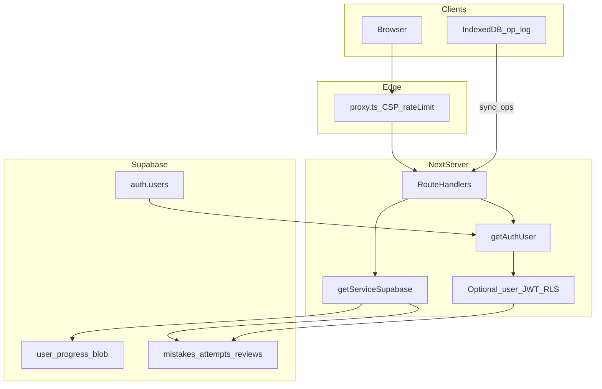

# DSE Level Up v6 Phase 4B 資料、保安、私隱與成本設計

- **狀態：** Phase 4B 完成；已批准進入 Phase 4C（見 `phase-4c-seo-testing-design.md`）
- **日期：** 2026-11-04（Asia/Hong_Kong）
- **前置：** Phase 1–4A；尤其 D1–D5、SEC 風險登記、`0030` 未批准上 production 嘅約束
- **方法：** 只做設計。**唔** apply migration、**唔**轉 key、**唔**改 RLS 到生產、**唔**搬學生資料。
- **硬閘：** 下列三項 P0 未書面確認前，本設計**不可**落地到 production：
  1. 生產／staging Supabase project 身分  
  2. 生產部署來源（`main`？）同 branch 保護  
  3. 事故負責人、backup／PITR、RTO、RPO  
- **Auth 憲章：** 唯一登入 = Supabase Auth · Google OAuth（`@supabase/ssr`）。**禁止**重建 Auth.js／Better Auth。下文「Auth design」係呢個棧嘅加固，唔係換 provider。

---

## 0. 設計原則

1. **預設拒絕：** 敏感表 RLS enable＋無寬 `USING (true)`（題庫公開 SELECT 例外已文件化）。  
2. **Server 再驗證：** 每個 Server Action／route handler 用 `getSyncUserId()`／`getAuthUser()`，唔信 client `user_id`／`role`。  
3. **雙寫遷移：** 舊 `user_progress` blob 作 read-only source，直至 checksum 0 丟失（D4）。  
4. **離線：** append／operation log；完成節 union；未完成節禁止牆鐘整節覆蓋（D5）。  
5. **成本：** 月帽 US$200；無 runtime breaker 前不開 Storage 上傳。  
6. **共用 IP：** 只限流、唔封禁；已登入優先 `user_id` 分桶。

---

## 1. Target data model

圖例：**現有** = repo／migration 已有；**邏輯擴展** = 要新 migration（未批准）；**延後** = 4A 延後功能先留位。

每個表列：現況、欄位、migration、index、PK／FK、RLS、角色、敏感欄、audit、retention、backward compatibility。

### 1.1 `profiles`

| 項 | 設計 |
|---|---|
| 現況 | `0030` 新建（`id` = `auth.uid()`）；舊表可改名 `profiles_legacy`。生產是否已 apply：**未驗證** |
| 欄位 | 現有：`id`、`email`、`display_name`、`avatar_url`、`created_at`、`updated_at`（以 0030 為準）。**新增（邏輯）：** `age_band`（`under_13`｜`13_15`｜`16_17`｜`18_plus`）、`consent_version`、`deletion_requested_at`、`deletion_status`（null｜`cooling`｜`processing`｜`done`）。**注意：** 家長通知邏輯涵蓋 16–18 歲（inclusive），`18_plus` 用戶在滿 18 歲翌日（18yo + 1 day）前依然納入家長通知帶，文件與程式邏輯必須明確記錄。 |
| Migration | 僅在 0030 狀態確認後；用 `ADD COLUMN IF NOT EXISTS`；nullable 預設相容 |
| Index | PK `id`；`deletion_requested_at` 部分索引（非 null） |
| RLS | 0030：SELECT／INSERT／UPDATE own；無 DELETE（刪帳走 service role） |
| 角色 | student：own；admin／founder：經 service role＋allowlist，寫 `audit_logs` |
| 敏感 | email、age_band |
| Audit | 電郵變更、刪除請求、年齡聲明 |
| Retention | D1：用緊就留；刪除請求後 7 日冷靜期可撤回，8–30 日內由 service_role 執行硬刪／不可逆匿名化（S1 預設）。保留期限與狀態機嚴格對齊 profiles 欄位。 |
| Compat | 唔刪 `email`；新欄 null 唔破舊 client |

### 1.2 `subjects`／`topics`

| 項 | 設計 |
|---|---|
| 現況 | **無**獨立 DB 表；正本 `data/subjects.ts`、題庫內 topic |
| 建議 | **唔強制建表**。若要 Knowledge Hub 外鍵，可用只讀 mirror 表 `subjects`／`topics`（id、name_zh、name_en、syllabus_year），由 sync script 寫入，同題庫一樣 anon SELECT |
| Migration | 可選；非 MVP 阻擋 |
| RLS | 公開讀；revoke 寫入（同 `questions`） |
| Retention | 內容非個人資料 |
| Compat | 應用繼續讀 TS 正本；DB 只係衍生 |

### 1.3 `questions`／`question_variants`

| 項 | 設計 |
|---|---|
| 現況 | `questions`＋`question_bank_versions`（0016／0017）；anon SELECT `USING (true)`；寫入 revoke |
| 欄位擴展（邏輯） | `source_kind`（original｜adapted｜public_derived）、`review_status`、`reviewed_at`、`reviewer_role`；**正本仍在 repo**，雲端鏡像欄由 sync 帶上 |
| `question_variants` | **新表（延後到變式引擎）：** `id`、`base_question_id`、`variant_question_id`、`relation`（`parallel_logic`） |
| Index | 現有 PK；`review_status` 若上雲 |
| RLS | 維持公開讀；**未審外露**若憲章未改，繼續靠 repo `hidden`／`pending`／`withdrawn` 過濾 loader，唔靠「雲端無列」單獨保證 |
| Compat | sync 加欄必須可空或有預設 |

### 1.4 `attempts` → 對齊 `practice_attempts`

| 項 | 設計 |
|---|---|
| 現況 | `0030.practice_attempts`（append-only SELECT／INSERT own） |
| 欄位 | 已有 `user_id`、`question_id`、`subject_id`、`topic_id`、`is_correct`、`elapsed_ms`、`difficulty`、`mistake_cause`、`created_at`。**加：** `session_id`、`attempt_kind`（`first`｜`redo`｜`review`）、`client_op_id`（idempotency）、`device_id` |
| Migration | 偵測表存在先 `ADD COLUMN`；**不可假設已上 production** |
| Index | 現有 user＋created；加 `(user_id, question_id, created_at)`；unique `(user_id, client_op_id)` WHERE client_op_id IS NOT NULL |
| RLS | SELECT／INSERT own；無 UPDATE／DELETE；擦除走刪帳 service role |
| 敏感 | 學習軌跡 |
| Retention | 跟帳戶；刪帳清 |
| Compat | UI 未接前雙寫：仍寫 blob，同時可選寫 attempts |

### 1.5 `mistakes`

| 項 | 設計 |
|---|---|
| 現況 | 邏輯上喺 blob／`dse_reverse_log`，**無**獨立表 |
| 新表 | `id`、`user_id`、`question_id`、`subject_id`、`topic_id`、`error_tag`、`selected`、`correct`、`source_attempt_id`、`first_missed_at`、`last_missed_at`、`repair_status`（`open`｜`due`｜`repaired`）、`checksum`、`legacy_ts` |
| Migration | staging table → dual-write → checksum → 切 read path（D4） |
| Index | `(user_id, repair_status, last_missed_at)`；`(user_id, question_id)` unique open-or-latest 策略用 partial unique |
| RLS | ALL own：SELECT／INSERT／UPDATE；DELETE 僅 own 或只准 service 刪帳 |
| WITH CHECK | `user_id = auth.uid()` |
| Retention | 跟帳戶；聚合可去識別（S1） |
| Compat | 讀路徑長時間仍可從 blob hydrate |

### 1.6 `review_items`／`review_schedule`

| 項 | 設計 |
|---|---|
| 現況 | 本機 `dse_review_done`＋`INTERVALS`；無伺服器表 |
| `review_items` | `id`、`user_id`、`mistake_id` 或 `question_id`、`due_at`、`interval_days`（3｜7｜14）、`status`、`completed_at` |
| `review_schedule` | 若只要一表可合併；分開方便 audit「排程變更」 |
| Index | `(user_id, due_at)` WHERE status open |
| RLS | own 完整四操作；WITH CHECK own |
| Retention | 跟帳戶；課題級舊 `dse_review_done` **保留**作 legacy（D4） |
| Compat | 客戶端繼續可算 due；伺服器作 source of truth（登入後） |

### 1.7 `error_tags`

| 項 | 設計 |
|---|---|
| 現況 | 枚舉散落 A／B／C |
| 建議 | **唔一定要表**；用 check constraint／app enum：`concept`｜`comprehension`｜`calculation`｜`format`｜`trap`｜`legacy_A`\|`legacy_B`\|`legacy_C` |
| 若建表 | id、label_zh、label_en、active——公開讀 |

### 1.8 `learning_plans`／`plan_tasks`

| 項 | 設計 |
|---|---|
| 現況 | 無；`learning_profiles` 有目標欄 |
| 狀態 | **延後引擎（H3）**；表可預留但不實作寫入 |
| 預留欄 | `learning_plans`：user_id、week_start、target_sessions、status；`plan_tasks`：plan_id、subject_id、task_type、done_at |
| RLS | own；延後期間唔 grant 也可只 service |

### 1.9 `mastery_snapshots`

| 項 | 設計 |
|---|---|
| 現況 | 客戶端 `lib/mastery.ts` 即時算 |
| 新表（可選） | user_id、subject_id、score_0_100、computed_at、algo_version |
| 用途 | 7／30 日趨勢唔靠重算全歷史 |
| RLS | SELECT／INSERT own；無任意 UPDATE 歷史（更正用新列） |
| Compat | 無表時儀表板繼續即時算 |

### 1.10 `content_reports` → 對齊 `question_reports`

| 項 | 設計 |
|---|---|
| 現況 | `0020 question_reports`；匿名 insert via service |
| 擴展 | `status`（received｜triaging｜confirmed｜corrected｜withdrawn）、`reporter_user_id` nullable、`resolution_note` 內部、`updated_at` |
| RLS | 維持 anon 不可直寫；學生 SELECT own 若有 reporter_user_id；admin service |
| Abuse | 內容 hash、每日帽、現有 rate limit（SEC-P2-003） |
| Retention | 修正後可留稽核；唔留 IP（現況） |

### 1.11 `content_provenance`

| 項 | 設計 |
|---|---|
| 現況 | UI＋repo flags；DB 質素框架 0024 |
| 選項 A | 欄位掛喺 `questions` 鏡像 |
| 選項 B | 表 `content_provenance`：question_id PK、source_kind、review_status、reviewer_role、reviewed_at、changelog jsonb |
| RLS | 公開讀已發布欄；內部 notes 唔 grant anon |
| Compat | sync 由 repo 衍生 |

### 1.12 `parent_consents`／`consent_logs`

| 項 | 設計 |
|---|---|
| 現況 | `privacy_consents`（0019）產品同意；付款時代 `consent_logs` **已刪**（0015）——**唔好復活舊表名含意** |
| `consent_logs`（新） | id、user_id、consent_type（`privacy`｜`sync`｜`parental`｜`age_declaration`）、version、actor_relation（`self`｜`parent`｜`legal_guardian`）、created_at、`ip_hash` nullable 短留、`evidence_hash` nullable、withdrawn_at、previous_consent_id（撤回時指向前一筆同意紀錄）。**嚴格 Append-only：** 絕對禁止 UPDATE。當用戶撤回同意時，**不得** UPDATE 既有紀錄，而必須 INSERT 一筆新紀錄，帶有 `withdrawn_at`、指向前次紀錄之 `previous_consent_id` 及相應事件中繼資料。 |
| `parent_consents` | child_user_id、guardian_user_id 或 guardian_contact_hash、relation、status、verified_at、method |
| RLS | 學生讀 own；guardian 流程經 server＋驗證；service 寫。政策規則：SELECT own, INSERT own/service, UPDATE deny, DELETE service only。 |
| Retention | D2；ip_hash TTL 短（建議 ≤ 30 日）；證據只存 hash |
| Compat | 現有 `privacy_consents` 保留；新類型另表或擴 type check |

### 1.13 `audit_logs`（對齊／擴 `founder_audit_events`）

| 項 | 設計 |
|---|---|
| 現況 | `founder_audit_events`（0029）零 policy＋revoke |
| 擴展 | 學生安全事件可另表 `security_audit_events`：actor_user_id、event_type、ip_hash、meta jsonb、created_at——**禁止**存 password／token |
| RLS | 零 policy；只 service；founder 讀經 allowlist API |
| Retention | ≥ 180 日建議（待法律確認）；刪帳唔刪安全稽核列時要去識別 actor |

### 1.14 保留嘅現有用戶表（摘要）

| 表 | 策略 |
|---|---|
| `user_progress` | 遷移期 source of truth；之後 read-only archive（S4：驗證後 +90 日） |
| `user_settings` | 維持；無障礙鍵不變 |
| `user_sessions` | 維持「今日開過」；唔當安全 session store |
| `privacy_consents` | 維持 |
| `push_subscriptions` | 補 revoke（0025）；token hash（0026）另批 |
| `practice_counts` | 匿名計數維持 |
| `founder_*` | 維持 deny-by-default |

### 1.15 離線 operation log（客戶端＋可選伺服器）

**客戶端 IndexedDB `dse_op_log`（設計）：**

- 欄位：`op_id`、`device_id`、`user_id`、`type`（`answer`｜`pause`｜`complete_session`｜`tag_error`｜`schedule_review`）、`payload`、`client_updated_at`、`synced_at`  
- 同步：POST `/api/sync/ops`（未來）idempotent upsert by `op_id`  
- 合併：完成節 → 投影到 `attempts`／blob union；未完成節 → 按 question／session deterministic merge，保留中間 op  
- **禁止**整份 snapshot LWW  

伺服器可選 `sync_ops` 表：同結構＋`user_id` RLS own INSERT／SELECT。

---

## 2. RLS design

### 2.1 預設

1. `ENABLE ROW LEVEL SECURITY`  
2. `REVOKE ALL FROM anon, authenticated`（再按需 GRANT）  
3. 無 policy = 對該角色 0 行  
4. `USING` 同 `WITH CHECK` 分開；UPDATE 兩者都要  
5. 舊 view：若日後建立，**必須** `security_invoker = true`；而家 repo **無 view**  
6. `SECURITY DEFINER` 函數：revoke execute from public／anon／authenticated（見 0031）

### 2.2 政策矩陣（目標態）

| 表 | SELECT | INSERT | UPDATE | DELETE |
|---|---|---|---|---|
| `questions`（公開） | anon／auth `true` | deny | deny | deny |
| `profiles` | own | own | own | deny（service 刪帳） |
| `practice_attempts` | own | own | deny（無 UPDATE） | deny（嚴禁學生 DELETE；只准 service_role 在刪除帳戶時清理） |
| `learning_*` | own | own | own where applicable | deny（嚴禁學生 DELETE 抹除學習歷程；只准 service_role 在刪除帳戶時清理） |
| `mistakes`／`review_*` | own | own | own | own／service |
| `consent_logs` | own | service or own limited | deny（純 append-only；撤回必須 INSERT 新列帶 withdrawn_at + previous_consent_id，絕無 UPDATE） | service only |
| `parent_consents` | 經 server 授權 | service | service | service |
| `security_audit_events`／`founder_*` | service／founder API | service | deny | deny |
| `question_reports` | own if logged in | service only | service | service |

### 2.3 防 IDOR／privilege／mass assignment

- API 一律 `eq('user_id', sessionUserId)`；忽略 body 內 user_id。  
- Progress／settings 維持 allow-list keys（`CLOUD_PROGRESS_KEYS`）。  
- Role 唔存在學生可寫欄；admin 只 env allowlist（統一 emailVerified 判斷——SEC-P1-007）。  
- 禁止 client 傳 `review_status` 改題庫。

### 2.4 生產對帳（落地前）

唯讀查：`relrowsecurity`、`pg_policies`、grants。對唔上 Phase 1 inventory 就停（SEC-P0-001）。

---

## 3. Auth design

### 3.1 棧

- Provider：Google OAuth only  
- Session：`@supabase/ssr` cookies  
- Server：`getUser()`；identity = `auth.users.id`  
- Callback：`/auth/callback`＋`safeInternalPath`  
- **唔**用 Auth.js adapter／JWT strategy  

### 3.2 Session validation

- Route／RSC／Action：每次 `getAuthUser()`／`getSyncUserId()`  
- `proxy.ts`：**唔**做登入閘（維持）；繼續 CSP＋限流  
- 可選加固：proxy 對 `/admin`／`/founder` 做 cheap cookie 存在檢查仍**唔**可取代 handler `require*`  

### 3.3 Role model

| 角色 | 機制 |
|---|---|
| student | 任何有效 Google session |
| reviewer | `REVIEWER_EMAILS`／`ADMIN_EMAILS`＋**真** email verified |
| admin | `ADMIN_EMAILS`＋真 email verified（改掉而家 `false`） |
| founder | email＋`FOUNDER_GOOGLE_SUB`＋verified |
| guardian | 非登入角色；經 `parent_consents` 驗證後嘅 server 流程 |

### 3.4 建議（非 MVP 必做）

- 2FA／passkey：Google 帳戶側；產品內可文案建議  
- Logout all devices：Supabase signOut scope／revoke；要查現版 API 後先定  
- Session refresh：依賴 SSR client；文件化閒置政策  

### 3.5 共用裝置（D5／S5）

1. 登出：清 session cookie＋嘗試同步  
2. 有未同步 op：強制提示「同步並清除」｜「放棄本機」｜「取消登出」  
3. 成功後：`wipeThisDevice()` 路徑清 localStorage、IndexedDB（題庫 cache 可保留無個人資料嘅 qbank DB，或整庫清——建議清個人 DB，題庫版本 cache 可留）  
4. 共用模式：閒置 15 分鐘鎖；短 session  

### 3.6 Server Action

- 現有只有 founder actions；學生 mutation 走 route handlers——保持  
- 任何新 `'use server'`：開頭 `require*`＋Origin check（學 founder）

---

## 4. Secret management

### 4.1 Inventory（名，唔寫值）

| Secret | 位置 | 可否 NEXT_PUBLIC |
|---|---|---|
| `SUPABASE_SERVICE_ROLE_KEY` | server／CI／scripts | **否** |
| `NEXT_PUBLIC_SUPABASE_ANON_KEY` | browser | 是（刻意） |
| `NEXT_PUBLIC_SUPABASE_URL` | browser | 是 |
| `CRON_SECRET` | cron route | 否 |
| `SENTRY_AUTH_TOKEN` | CI upload | 否 |
| `NEXT_PUBLIC_SENTRY_DSN` | browser | 是 |
| VAPID private／public | push | private 否 |
| `ADMIN_EMAILS`／`REVIEWER_EMAILS`／`FOUNDER_GOOGLE_SUB` | server | 否（founder 測試已鎖） |

### 4.2 規則

- `utils/supabase/server.ts` 必須 `import 'server-only'`（SEC-P1-003）  
- 禁止 service key 出現喺 client 模組（已有 question-cloud 測試）  
- CI secret scan **block PR**（而家 CI 無——Milestone A 加）  
- Preview 唔好共用 production service role（文件風險）——改 per-env  
- Rotation：懷疑外洩 → 即撤 Supabase key＋輪轉 cron／vapid；checklist 入 incident  

### 4.3 Forbidden patterns

- `NEXT_PUBLIC_*SERVICE*`  
- 把 service key 寫入 log／error toast  
- Commit `.env`（只准 `.env.example` 占位）

---

## 5. Storage、成本與離線

### 5.1 Storage

- **而家無 bucket。**  
- 若將來開放：MIME allow-list、每檔 ≤ 固定 KB、每 user soft／hard quota、上傳用 advisory lock／transaction、egress 監察。  
- **無成本 circuit breaker 前禁止全量開放。**

### 5.2 成本

| 控制 | 設計 |
|---|---|
| 靜態帽 | `qa:budget` US$200 維持 |
| 題庫 egress | 維持 IndexedDB 版本比對；異常拉取告警 |
| 列增長 | `practice_attempts`／`mistakes` 估算後先雙寫；超帽停寫新表、回落 blob |
| Circuit breaker | 日用量超閾值 → 拒絕非必要寫（reports 過量、sync 爆發）；**讀題靜態回落仍可用** |
| 告警 | Founder finance／ops；電郵或現有 incident 表 |

### 5.3 離線／PWA

- 文字優先；圖片 on-demand；cache 版本化＋LRU  
- `NEXT_PUBLIC_SW_OFFLINE` 預設謹慎  
- 合併：§1.15；完成節 union 已存在於 `lib/sync.ts`——未完成節改 op log  
- 登出清個人 cache（§3.5）

### 5.4 限流（對齊 D5）

| 主體 | 目標 |
|---|---|
| 已登入 | 每 `user_id`＋**route class** 分桶（唔好全球 20／min 打死 progress＋count） |
| 匿名 IP | 60／min；burst 100 |
| 白名單 CIDR | burst 500；**只 log 唔 block**；管理員審批 |
| practice-count | 落地前維持 120／10 min 學校友善 |
| 實作 | 先記憶體；Redis 另批（成本） |
| 轉發頭 | 確認平台覆寫 `X-Forwarded-For`；否則唔信任 |

---

## 6. Threat model

| 威脅 | 緩解（設計） |
|---|---|
| Account takeover／credential stuffing | Google only；auth 桶限流；登入 audit；異常告警 |
| IDOR | session 綁定；RLS own；測試 Student A→B = 0 行 |
| Privilege escalation | allowlist＋verified；唔信 client role |
| XSS | CSP nonce；唔把 `sensory_pref` 當 HTML；React 預設 escape |
| CSRF | SameSite cookie；JSON API；founder Origin check |
| SQLi | 參數化 Supabase client；禁拼 SQL |
| Mass assignment | allow-list |
| Rate-limit bypass | 分桶＋唔信可偽造頭；白名單唔等於無認證 |
| Data exfiltration | RLS；admin API 聚合去識別；audit |
| Supply chain | `npm audit`；lockfile；禁亂加依賴 |
| DDoS | 平台＋限流；降級靜態練習包（既有演練稿） |
| Content tampering | 題庫寫入只 service／sync；revoke anon 寫 |
| Storage abuse | 未開放；開放則 quota＋lock |
| Cost abuse | breaker＋題庫版本 cache |
| Shared-IP false positive | 唔封禁；user_id 桶；白名單 log |
| Shared-device leakage | 登出清＋S5 提示 |
| Offline merge loss | op log；checksum；禁止 LWW 整節 |

升級既有稿：`docs/security/H-THREAT-MODEL-AND-INCIDENT-DRILL-2026-10-29.md`（仍標 Auth.js 處要以本文件為準）。

---

## 7. Logging and monitoring

### 7.1 要記

登入成功／失敗、密碼重設（若將來有）、email 變更、新裝置（粗：user-agent hash）、權限變更、授權失敗、admin／founder 修改、內容發布／下架、資料匯出、異常 API 量、Storage 異常用量、成本異常、共用 IP 異常、離線合併失敗、遷移 checksum 異常、刪除請求狀態變更。

### 7.2 唔記

Password、API key、完整 session token、OTP、題目全文喺安全 log、長期原始 IP（只用短留 hash）。

### 7.3 通道

- `safeLog`（現有）  
- `founder_audit_events`／未來 `security_audit_events`  
- Sentry（Replay 關；無 PII 麵包屑政策）  
- 產品指標事件另冊（Phase 3 清單；另批埋點）

---

## 8. Backup and incident response

### 8.1 Backup／PITR

| 項 | 設計 |
|---|---|
| Backup schedule | 依 Supabase 計劃；**要書面確認** |
| PITR | 遷移前必須 on＋restore drill（SEC-P0-002） |
| RTO／RPO | **待創辦人定**；文件只列「待驗證目標」，唔當 SLA |
| Rollback | migration 只 additive；feature flag off；read path 切回 blob |
| Checksum | D4 key；mismatch → 人工，禁自動覆蓋 |

### 8.2 Incident severity（建議）

| 級 | 例 | 初響 |
|---|---|---|
| SEV1 | 多用戶資料外洩、service key 外洩 | 即宣告；撤 key；可停寫 |
| SEV2 | 單用戶 IDOR、大規模 429 誤傷全校 | 1h 內圍堵 |
| SEV3 | 單點 bug、成本告警 | 工作時內 |

### 8.3 角色

- **Incident commander：** P0 問題 #3 未答前 = **未指定**（阻擋 Level 3 演練合格）  
- 技術：可輪值 founder／工程  
- 對外溝通：創辦人批准模板  

### 8.4 Containment steps（摘要）

1. 偵測／分類（≤ 30 min 目標）  
2. 宣告、頻道、時間戳決策 log  
3. 停帳、撤 key、限流、關旗、暫停 Storage 寫  
4. 影響評估、用戶清單  
5. 通報決策（≤ 24h 目標）  
6. 修復、restore drill 若需要  
7. 72h 內 post-mortem  

### 8.5 模板

- 內部 post-mortem：時間線、影響、根因、行動項、跟進 owner  
- 外部聲明：承認範圍、學生叮囑（改密／留意電郵）、聯絡、唔承認未證實事項  

對照演練情境 A–D：沿用 H 文件，改 Auth 描述為 Supabase Google。

---

## 9. 刪除權同同意（D1／D2 落地設計）

### 9.1 刪除狀態機

`null` → 用戶請求 → `cooling`（7 日可撤回）→ `processing` → 刪應用表＋`auth.users` 或不可逆匿名化 → `done`＋憑證 id  

- 冷靜期內登入可撤回。  
- `USER_SCOPED_TABLES` 擴至新表；測試繼續鎖登記表。  
- 安全 audit 列去識別後可留。  

### 9.2 同意

- 新登記：年齡聲明；under_13 要 `parent`／`legal_guardian` 先同步。  
- 現有用戶：補錄唔鎖舊進度。  
- S2 工作預設：13–15 歲強制家長同意；16–18 歲（含 18 歲整至 18 歲翌日 18yo + 1 day）實施家長通知（parental-notification band）。即使在資料欄位聲明為 `18_plus`，在其出生滿 18 歲翌日之前，一律納入 16–18 歲家長通知邏輯，不可因標籤而遺漏。

---

## 10. 遷移計劃（設計，唔執行）

1. 確認 PITR＋drill  
2. 快照 `user_progress`  
3. 建 `mistakes`／`review_items`／擴 `practice_attempts`（staging 先）  
4. 回填腳本＋逐筆 checksum  
5. Dual-write  
6. 影子讀比較  
7. 丢失率 0 → 切 read  
8. Blob 留 90 日（S4 預設）  
9. 任何一步失敗 → 讀路徑回滾，表可留  

**禁止：** TRUNCATE、無 checksum 覆蓋、生產未對帳就 ENABLE 寬政策。

---

## 11. 開放問題（4B）

1. 三項 P0  
2. S1–S5 最終一句  
3. 學生 JWT＋RLS 直寫 vs 維持純 service role（建議：新表可 user JWT；舊 blob 維持 service）  
4. 題庫 cache IndexedDB 登出時清唔清  
5. RTO／RPO 數字  
6. 是否採用獨立 `security_audit_events` 還是擴 founder 表  

---

## 12. Phase 4B 完成清單

### 已完成項目

1. Target data model（含現有／新增／延後）  
2. RLS 矩陣同防 IDOR  
3. Auth（Supabase）加固同共用裝置  
4. Secret、Storage／成本／離線／限流  
5. Threat model  
6. Logging  
7. Backup／incident  
8. 刪除／同意／遷移設計  

### 產出檔案

- `docs/update-v6/phase-4b-data-security-design.md`

### 發現嘅風險

- P0 未答 → 本設計不可落地。  
- 0030 同生產不一致會令 RLS 假設崩。  
- User JWT 同 service 雙路徑若唔統一測試，易漏政策。  
- 列增長可能撞 US$200／DB 容量。  

### 未解決問題

- 第 11 節。  

### 下一 Phase 建議

- **Phase 4C：** SEO／AEO／GEO 同測試設計（含本地指令）。  
- 仍然唔開 Milestone A code，除非另批；**尤其唔**做 production migration。  

### 需要你確認嘅決策

1. 三項 P0  
2. S1–S5  
3. 新學習表：user JWT＋RLS 還是只 service role  
4. Incident commander 人選  
5. Blob 保留 90 日（S4）是否定案  

**Phase 4B 完成，等待批准。**
