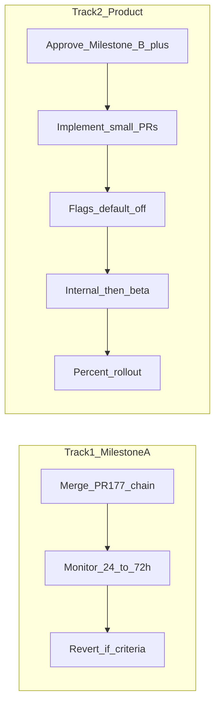

# DSE Level Up v6 Phase 9 發布計劃

- **狀態：** **SUPERSEDED**（2026-11-04）——見 [`phase-5-10-reset.md`](./phase-5-10-reset.md)。兩軌思路可參考，唔當已批准 deploy。  
- **原狀態（作廢）：** Phase 9 完成，等待批准  
- **日期：** 2026-11-04（Asia/Hong_Kong）  
- **前置：** Phase 8 隔離驗收；[`phase-5-status.md`](./phase-5-status.md)  
- **硬原則：** **唔好直接 100% 發布全量 v6 產品。** 本計劃分兩軌。  
- **本 Phase 產出：** 計劃文件。**未**執行 production deploy、**未** apply migration、**未**輪 key。

---

## 0. 兩軌總覽

| 軌 | 範圍 | 可否而家推進 | 發布形態 |
|---|---|---|---|
| **軌 1 · Milestone A** | secret scan、server-only、verified admin／reviewer、登出 wipe 接線、route-class 限流、CI audit、runbook | **可以**（技術驗收有條件 Pass） | 合併 PR 鏈 → production；行為多數即時生效（限流／登出），無產品 feature flag 需要「開」 |
| **軌 2 · Milestone B–G** | 私隱同意、內容 provenance、練習解剖、錯題閉環、離線 op-log、Hub／SEO 等 | **否**（未實作；Phase 8 = N/A） | 每個 milestone 另批 → flag 預設 off → 內部 → beta → 百分比 |

**禁止：** 把軌 2 當成已可 5%→100% 開放。

---

## 1. Approval record（待創辦人勾）

| 項 | 狀態 |
|---|---|
| 批准本 Phase 9 **計劃文件** | 本回合「批准進入 Phase 9」= 批准**寫計劃**；**唔等於**批准立刻 deploy |
| 批准 **合併軌 1**（PR #177 及文件鏈 #178–#180） | **待勾** |
| 批准 **開始軌 2 Milestone B** | **待勾**（另句） |
| 三項 P0 書面答案 | **未答** → 軌 2 資料／RLS／遷移仍然鎖死 |
| Incident commander 人名 | **未定** |

簽署建議：合併軌 1 前，創辦人回覆一句「批准合併 Milestone A」。

---

## 2. Track 1 — Milestone A 發布

### 2.1 Release checklist

- [ ] PR #177（A code）CI 綠：secret:scan、audit high+、test、qa、eslint、build（8GB）、SEO smoke  
- [ ] 文件 PR 鏈（#178 Phase 6 → #179 Phase 7 → #180 Phase 8）審過或 squash 合併策略已定  
- [ ] 確認 **無** migration 檔被 apply  
- [ ] 確認 Preview 唔共用 production `SUPABASE_SERVICE_ROLE_KEY`（P0 相關；至少文件風險已知）  
- [ ] 合併後抽樣：登入、練習、progress sync、admin 未驗證電郵拒入  
- [ ] 合併後 24–72h：429 率、5xx、Sentry、學校時段誤傷  

### 2.2 Feature flags（軌 1）

| 行為 | Flag？ | 說明 |
|---|---|---|
| `secret:scan`／CI audit | 無（CI only） | 合併即生效於 PR |
| `server-only` | 無 | build-time 保護 |
| Admin／Reviewer verified email | 無 | 合併後即收緊；若誤傷內部帳，用 Supabase 驗證電郵或暫改 allowlist（唔好關驗證） |
| Route-class 限流 | 無獨立 flag | 合併後即生效；緊急時 revert proxy／rateLimit commit |
| 登出 wipe | 無獨立 flag | 合併後即生效；屬 D5 安全行為 |

軌 1 **唔**引入新產品 flag 框架；緊急控制 = git revert／Vercel rollback。

### 2.3 Migration plan（軌 1）

**無。** 零 schema 變更。

### 2.4 Rollout steps（軌 1）

1. 合併 A → `main`（假設 `main` = production source；**P0 仍待確認**）  
2. Vercel production 自動／手動 deploy  
3. 內部帳號煙測（15–30 min）  
4. 監察 24–72h（唔做百分比流量分割——限流係全站行為）  
5. 若觸發 rollback criteria → Vercel rollback + 必要時 revert  

### 2.5 Rollback criteria（軌 1）

| 條件 | 動作 |
|---|---|
| Error rate > 1%（相對基線） | Rollback deploy |
| 學校／宿舍時段大規模 429 誤傷（客訴或指標） | 先放寬 sync／count class 限額 hotfix，或 revert 限流；**唔** IP ban |
| P0 私隱／保安事故（含 service key 外洩跡象） | 即撤 key（secret runbook）＋rollback |
| 登出 wipe 導致大規模進度投訴且同步路徑壞 | Hotfix sync 或暫回舊登出（保留 wipe 安全討論） |
| INP > 300ms 大面積（若有 RUM） | 評估是否 A 引起；否則另案 |
| 成本超預算／egress 異常 | 關非必要寫；A 本身唔開 Storage |

### 2.6 Monitoring（軌 1）

- Sentry：5xx、auth callback  
- 平台：429 數量（尤其 `/api/progress`、`/api/practice-count`）  
- Uptime：`/api/health`  
- 人手：合併後首日學校繁忙時段抽查  

### 2.7 On-call

| 角色 | 狀態 |
|---|---|
| Incident commander | **未指定**（P0） |
| 技術 | 創辦人／工程（合併窗口自行值班） |
| 對外 | 創辦人批准先發 |

---

## 3. Track 2 — 產品 milestone（未開工）

### 3.1 先決

1. 創辦人批准個別 Milestone（B→G）  
2. P0 答案（凡涉 DB／RLS／遷移）  
3. Phase 6 Blocked 項隨 milestone 解鎖後重測  

### 3.2 每個產品 milestone 嘅發布骨架

1. **Deploy code，flag 預設 off**（用既有 `founder_feature_flags` 或 env／`VERCEL_ENV` 閘——具體每里程碑定）  
2. 內部團隊啟用  
3. 小規模 beta：共用 IP、共用裝置、低網速、離島、跨境、少數族裔、SEN 情境盡量覆蓋  
4. 監察 24–72h  
5. 逐步開放：內部 → 5% → 25% → 50% → 100%（**只適用有旗標嘅產品面**）  
6. 每階段有 rollback criteria  
7. Migration **必須** backward compatible；先 staging＋PITR drill  

### 3.3 額外 rollback criteria（軌 2）

- RLS rejection 異常上升  
- 遷移丢失 > 0  
- 離線合併失敗率 > 5%  
- 共用 IP 誤 block > 0  
- 未審核內容外露  
- Storage egress／成本超預算  

### 3.4 軌 2 暫緩清單

同意／刪除狀態機、Hub、`llms.txt`、三層解剖、錯題修復引擎、op-log、axe CI、Playwright——全部 **未排進本 Phase 9 部署**。

---

## 4. Communication plan

### 4.1 內部

- 合併軌 1 前：工程頻道貼 checklist＋rollback 連結  
- 合併後：狀態「A 已上；產品 v6 未全開」

### 4.2 學生（如需要）

軌 1 多數為後台保安，**可唔發**公開變更日誌；若登出清除引起疑問，客服稿：

> 為咗喺學校電腦等共用裝置保護你嘅練習紀錄，登出前如果未能同步，我哋會請你確認。確認後會清除呢部裝置上嘅本機學習資料。雲端已同步嘅進度喺你再次登入仲喺度。

### 4.3 家長易讀版（軌 1）

- 我哋加強咗網站保安同登出後嘅本機清除，減少其他人喺同一部電腦見到學生進度。  
- 仍然免費、無廣告、唔賣數據。  
- 未改變「要家長同意先用」等法律流程嘅正式上線（呢部分仲未做）。

### 4.4 少數族裔摘要（EN／暫）

- We improved sign-out so shared computers are less likely to show another student’s progress.  
- The site stays free; no ads; we do not sell student data.  
- Full parental-consent and new learning features are not in this security-only release.

（印尼文／烏都文摘要：等 Milestone B 多語一併交。）

---

## 5. 成本

| 項 | 計劃 |
|---|---|
| 軌 1 | 無新付費服務；維持 `qa:budget` |
| 軌 2 | 每 milestone 估列增長；無 breaker 不開 Storage |
| 監察 | 沿用 Sentry／Vercel；唔另購 APM（除非另批） |

---

## 6. 明確唔做（本 Phase 執行層）

- 唔喺未勾「批准合併 Milestone A」前 merge／deploy  
- 唔 100% 開啟未建產品功能  
- 唔 apply `0030` 或任何 production migration  
- 唔輪 production keys（除非事故）  

---

## 7. 下一步

1. 你回覆是否 **批准合併 Milestone A（軌 1）**  
2. Phase 10：對軌 1 做發布後驗證模板（產品指標多數 N/A）  
3. 另批 Milestone B 或答 P0  

**Phase 9 完成，等待批准。**
